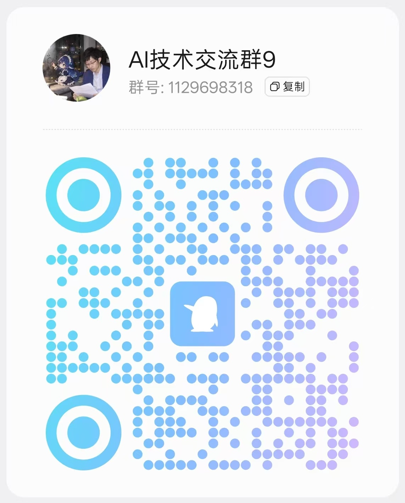

<div align="center">
  

# dsh-our-free-model

[简体中文](README.md) | **English**

  
  
  
  
  
  <br>
  <a href="https://trendshift.io/repositories/261203"></a>
  <a href="https://trendshift.io/weekly?language=JavaScript"></a>
  <br>
  <sub>Trendshift JavaScript Weekly #1 · October 5-11, 2026 · Ranking in progress, as of October 11, 2026</sub>

</div>

<div align="center">

> All you do is install this plugin in dsh — no login, no sign-up, no API key, no other
> step of any kind. The frontier models are simply there, DeepSeek V4.1 Flash and
> Kimi K3 among them. Completely free, with no usage cap.
>
> 你只需在 dsh 里装上这个插件，无需登录、注册、填 API Key 或任何其它操作，就能用上包括
> DeepSeek V4.1 Flash、Kimi K3 在内的前沿模型——完全免费，不限量。
>
> The roster follows upstream, availability is measured from **your own** network
> egress, the thinking-effort control sends a real budget instead of a prompt hint, and
> a local OpenAI-compatible forward port comes included.
>
> It mounts as a pure plugin: no core changes, no build step, zero dependencies.

</div>

---

## Community

<div align="center">
  
  <br>
  <b>QQ group: 883073874 (ai技术交流群8)</b>
  <br>
  Scan the QR code or search for the group number to join, discuss the plugin, report issues and share tips.
</div>

---

## What it is

A pure mount for dsh: it changes no kernel code, needs no build step, and has no runtime dependencies.

Models come from OpenCode's keyless gateway, Kilo's public free pool, the desktop-only EAC co-paid lane, your own keys on the aggregate lane (76 providers built in), and ten account channels you can sign in to.

Everything is picked and tuned inside dsh: the model picker groups by availability, the Effort menu sends a real thinking budget, and the settings page holds the model list, dashboard, local forward port, gateway, announcements and upgrades. Usage, settings and account credentials stay on your machine.

## Install

```bash
dsh plugin --profile web add /absolute/path/dsh-our-free-model
```

Restart the app once afterwards, and replace `--profile` with the profile you actually use.

> **⚠️ Do not install this plugin from npm.**
>
> The `dsh-our-free-model` package on npm is **not published by this repository**. A third
> party packed it with a modified `index.js` and `client.js`, plus a
> `src/channel-visibility.js` this repository has never had. Installing it gets you a build
> nobody reviewed here, and no signature checks or in-app upgrades.
>
> Install it the ways described in this document instead: a Release package from this
> repository, or a local checkout. Wherever else a package with the same name shows up,
> this repository is the one to trust.

There is one more restriction on desktop: Electron's `desktop` profile is managed by the app itself, so install or upgrade from Settings → Plugins. The CLI only works for plain web profiles.

<details>
<summary>Profile gate in desktop bundles, and manual tarball installs</summary>

Some DSHEAC AIO / older desktop bundles check the profile before starting the web server and reject symlinks and directory junctions. You may see:

```
PROFILE_UPGRADE_REQUIRED: offline dependency migration is not yet available
```

Use the in-app plugin manager on such hosts, or install from a local tarball built from trusted source:

1. Put the package in `<DSH_HOME>/profiles/<profile>/vendor/`:
   `npm pack --ignore-scripts --pack-destination "<DSH_HOME>/profiles/<profile>/vendor"` (a Release tarball of the same version works too).
2. Add `"dsh-our-free-model": "file:./vendor/dsh-our-free-model-2.5.9.tgz"` to the profile's `package.json`, then run the host's dependency install.
3. Append `"dsh-our-free-model"` to `dsh.profile.bundles`.

If a package manager owns this install, set `distribution` to `managed` in the bundle config or the plugin's `settings.json`. In-app upgrades, the announcement feed and hot reload are disabled then; the model lanes keep working. Two writers touching the same directory will corrupt the install.

When copying by hand, copy the whole package: `adapter/`, `src/`, `locale/`, and `vendor/channel-pack/` with `pack.js`, the WASM file, LICENSE and NOTICE. Copying only the entry files breaks channel loading.

Do not add entries to `cordis.patch.yml`. A package referenced by `dsh.profile.bundles` applies its own patch layer automatically; registering it twice fails with `duplicate loader entry id: our-free-model`.

</details>

<details>
<summary>Common install failures</summary>

**`ERR_PNPM_VIRTUAL_STORE_DIR_MAX_LENGTH_DIFF`**
This comes from stale pnpm state in the profile, not from the plugin. Close dsh, delete the profile's `node_modules` and `pnpm-lock.yaml` so they get rebuilt, then install again.

**`git ls-remote "git+ssh://git@github.com/..."` fails during a marketplace install**
pnpm resolves git sources with the local git binary. If git rewrites URLs through `insteadOf` (commonly https to ssh), or the machine has no usable SSH key, the install fails before any plugin file is downloaded. Either fix the git config and confirm `git ls-remote https://github.com/Ebony-Vinyl/dsh-our-free-model.git` works, or use a Release archive: unzip it and run `dsh plugin add <directory>`.

**`profile "desktop" is managed exclusively by the Electron application`**
A host protection, not a plugin problem. Desktop plugins are managed in the app; CLI installs only apply to plain web profiles.

</details>

## macOS desktop build (community)

The desktop app ships for Windows only. The macOS build is community-made: the changes are in [PR #421](https://github.com/Ebony-Vinyl/dsh-our-free-model/pull/421), and you can build it yourself with `npm --prefix packages/desktop run build`; the pipeline lives in `.github/workflows/build-macos.yml`. Only Apple Silicon builds exist at the moment.

It is neither signed nor notarized by Apple, so Gatekeeper blocks the first launch. "Damaged" does not mean the file is broken:

```bash
# Try right-click → Open first; if that fails, clear the quarantine flag
xattr -cr "/Applications/Our Free Model.app"
# Newer macOS may also need
sudo xattr -rd com.apple.quarantine "/Applications/Our Free Model.app"
```

## Usage

**Pick a model.** Choose the `Our Free Model` group in the model picker. Models the upstream blocks by region go to their own `region-limited` group and stay visible. Models declared but not routed never enter the picker; they stay in the settings page with the refusal reason.

**Adjust thinking effort.** The Effort item in the same menu. Models with declared levels (DeepSeek V4.1 Flash, GLM 5.3 Flash and others) get their own level menu and the value is sent as-is. The rest use Light / Balanced / Deep, which map to 2K / 8K / the model's ceiling in output budget; models that cannot disable thinking shift the whole ladder up. Model cards in the settings page print what each level actually sends.

**Call it from other local tools.** Settings → Our Free Model → Local forward: enable it, copy the base URL and generate a key.

- `GET /v1/models`
- `POST /v1/chat/completions` (streaming and non-streaming)
- `POST /v1/responses`
- `POST /v1/messages` (Anthropic Messages, streaming and non-streaming)
- `POST /v1/messages/count_tokens` (local estimate; the plugin ships no tokenizer)

A busy port is not a silent failure: the listener retries a few times, then moves to the next free port and writes the actual port back to settings. On Windows the usual culprit is a `netsh interface portproxy` rule; `netsh interface portproxy show all` lists them.

**LAN access.** Below the same panel, off by default. When enabled, the relay binds a routable address, requires its own LAN key (not interchangeable with the local key) and only forwards the five `/v1/*` routes above. Anyone who can reach this machine can spend its free quota through it, so keep it on trusted networks only.

**Announcements and upgrades.** The repository pushes announcements; the plugin polls every 30 minutes by default, and `urgent` items open a full-screen modal. Upgrades run from the settings page in one click: download, verify, back up, replace, hot reload, with automatic rollback on failure.

The settings page holds: model list, EAC authorization, announcements, dashboard, local forward, gateway, aggregate lane, token savers, routing, upgrades, recommended projects.

## Standalone service

If you would rather not install dsh, `packages/standalone` is a local service of its own. It uses `~/.our-free-model` and port 18900 by default, brings its own API key and web console, and supports the same free lane, EAC and account channels.

```bash
npm run start:standalone
```

Open the one-time admin link printed in the terminal. Options and verification are in [packages/standalone/README.md](packages/standalone/README.md). No installer or Release yet.

## Features

- **Aggregate lane.** Bring third-party endpoints into the same roster. 76 providers ship in `src/providers/registry.json`; after you add a key, their models appear as `provider/model`. Keys go to the local `0600` `settings.json` and the API echoes only `hasKey` and a `…abcd` fingerprint. The Test button is a listing probe: it verifies a key without spending a generation.
- **Token savers.** Tool output compaction (git diff/log, grep, find, ls, tree, build logs) rewrites `tool_result` before the request goes out; error output and small results are left alone. There are also caveman / ponytail prompt levels (off by default) and five local answers.
- **Routing.** Chain models across lanes into `combo:<name>`, with `fallback` (always start at the head) and `round-robin` (rotate the start). A link that fails before any text is emitted is dropped entirely, so the caller never sees the switch.
- **Local gateway.** Besides Chat Completions and Responses it speaks native Anthropic Messages (thinking, tool_use, real stop_reason and in-stream error events). The gateway page generates copy-ready recipes for Claude Code, Codex, the SDKs and curl against the real port.
- **Ten account channels.** LobsterAI, Qoder and Qoder China, TRAE, Cline, Loomy, Raccoon, MiniMax Code, ZCode and Gemini. Credentials go to the host credential store; sign-in steps and limits live in the settings page.
- **Usage dashboard.** Token heatmap, cumulative curves, output speed and time to first token, all local.
- **Announcement center and hot reload.** Allowlisted HTML, unread markers, OS notifications; upgrades and code changes reload without a restart.

## Code map

```
index.js                 host half: adapter registration, probing, storage, routes, forward, upgrades
adapter/kernel.js        the only place allowed to import @deepseek-ai/*
src/adapter.js           structural LlmAdapter
src/upstream.js          credentials, session ids, endpoint per wire protocol
src/stream.js            chat / messages / responses decoding into one shape
src/forward.js           local OpenAI-compatible listener + Anthropic Messages
src/aggregate.js         aggregate lane: rows, key masking, listing probe
src/token-saver/         tool output compaction and prompt injection
src/combos.js            fallback chains
src/updater.js           in-app upgrades: signature, hashes, backup, rollback
client.js                browser half, a hand-written ModuleLoader bundle
```

A few choices worth knowing:

- **One adapter, two provider routes.** The picker groups by provider and the roster format has no group field, so `region-limited` needs a second route; once the region gate lifts, the empty group is dropped by the client and the two merge.
- **Structural adapter, no import of `@deepseek-ai/dsh-llm`.** The kernel never does an `instanceof` check, so duck typing is enough, and the same code runs on 0.1.5 and 0.1.7.
- **The body decides, not the Content-Type.** Under load the upstream answers `200 + application/json` over a full SSE stream. Trusting the header reads the whole turn into a string and fails to parse it, and can demote a working model to unreachable. The plugin sniffs the first chunk and replays the bytes it already read into the stream.
- **Compaction sits at one choke point and fails open.** A broken compactor is skipped, a broken filter passes content through, an unknown shape is left alone. A request must never fail because of a step meant to make it cheaper.
- **A truncated long-thinking turn gets one retry.** It triggers only when the first segment produced thinking with no text and no tool call; the retry disables tools, asks for at most 800 words, and returns `STREAM_CUT` if it fails. Details in [docs/issue-12-recovery.md](docs/issue-12-recovery.md).

## Known limits

- "No usage cap" means there is no quota system, not that there is no rate limit. The lane meters per session, answers 429 when hammered, and the next probe recovers.
- Some models are simply slow upstream: `nemotron-3.5-lightning-free` measured over 30 seconds to first token. The dashboard reports it as it is.
- Output speed sometimes shows `—`: when the answer lands in one or two large frames, or the model never streams its thinking, there is no measurable window. The dashboard leaves it blank rather than counting thinking time as output speed.
- Thinking is silent and shares the output budget. `mimo-v2.6-flash-free` measured 60 to 70 seconds of silence while billing 3,024 reasoning tokens without sending a frame. Heartbeats keep the connection alive but do not fix the timeout; raise the output ceiling or use a model marked `reasoning: false`.
- Recovery has count, time and context limits. It re-requests from a checkpoint, so it cannot preserve upstream state and does not always succeed.
- Capability labels only state what probing can prove.
- The source is plain JavaScript. A local plugin cannot be anything else: anyone who can read the directory can read the gateway logic, and obfuscation does not change that.
- The upgrade trust root is an Ed25519 public key pinned in the plugin. Only signed manifests install, poisoning a mirror just makes upgrades fail, and whoever holds the release key is equivalent to whoever can push to the repository.

## Development

Node `^22.19.0 || >=24.0.0`, no install step, no dependencies.

```bash
npm test                             # all offline suites + manifest consistency
node scripts/client-lint.mjs         # browser half: copy keys, style keys, bundle executes
node scripts/offline-test.mjs        # offline end to end
node scripts/host-selftest.mjs       # real network, spends free quota
node scripts/build-manifest.mjs      # regenerate the release manifest (needs the release key)
npm run typecheck                    # strict check of the adapter seam; needs typescript
```

The release manifest must be signed (`--key` or `OFM_MANIFEST_KEY`); the builder rejects unsigned manifests. The private key never enters the repository or any distribution.

Per-release verification lives in [docs/releases/](docs/releases/) and [docs/verification/](docs/verification/). Scripts in `scripts/probes/` are one-off evidence from the investigation, dial upstream directly, and are not part of the test suite.

## EAC lane (desktop only)

On desktop the plugin adds a co-paid lane whose models carry an `EAC` prefix. It only appears after host admission: DSHEAC AIO (Tauri shell) needs the kernel path, the embedded node and the web-desktop profile to match at once; DeepSeek Harness desktop and DSH Tauri accept the `desktop` / `tauri` profile the kernel reports. Command-line arguments do not count.

Channel credentials are sealed with AES-256-GCM; the key is derived at unlock time from three masks split across two files, and plaintext exists only for the frame that builds the request. GitHub authorization is separate: sign in and star the repository, and the gateway issues a conversation token, rechecked every 12 hours by default.

`worker/` holds an optional Cloudflare Worker gateway; rotate the signing secret there and every client is revoked at once. Deployment is in [worker/README.md](worker/README.md).

## Where the models come from

All direct, no account pools, no relaying:

| Purpose | Target | Credentials |
| --- | --- | --- |
| free lane inference and roster | `https://opencode.ai/inference/v1/*` | `Bearer public`; the lane itself is the public keyless quota |
| Kilo free pool | `https://api.kilo.ai/api/gateway/*` | none; no account, key or session |
| announcements and upgrade manifest | this repository's `feed/*.json`, raw.githubusercontent.com first, jsDelivr as fallback | none |
| egress region check | api.ipify.org / ipinfo.io / ipapi.co, only the public IP and country | none |

Your prompts, tool results and images go to the upstream behind the model you picked, as with any model API. Nothing else leaves the machine: usage, settings and keys stay in `DSH_HOME/our-free-model/`.

Keyless does not mean unmanaged: the free lane fingerprints clients through `x-opencode-*`, meters per session, returns 403 for regions and 429 when over quota. Kilo's free pool states in its model cards that prompts may be logged upstream and used to improve their services; do not send sensitive content.

## Disclaimer

- This plugin is a client, not a model provider. Responses come from the upstreams; the plugin does not host, rewrite or filter them.
- Free quota is offered by the upstreams and can be throttled, priced or withdrawn at any time. Do not send passwords, keys, identity data or business secrets through it; use your own paid API for sensitive work.
- Using a channel means accepting that upstream's terms; throttling or bans from misuse are on the user.
- The EAC lane is co-paid: its credentials and gateway are run by the maintainers and limited to authorized users. Do not resell or share access.
- This project is not affiliated with or endorsed by any model provider; names and trademarks belong to their owners.

## Security and privacy

Settings, usage and aggregate keys live in `0600` files under `DSH_HOME/our-free-model/`. The API echoes only `hasKey` and a `…abcd` fingerprint.

The forward listener binds loopback only, and `POST /settings` rejects a routable address. LAN access is a separate door: the relay binds a routable address, every request needs the LAN key (including `/health`), and only the five `/v1/*` routes above are allowed.

Plugin routes carry a request trust fence. Compositions with a connection service (dsh web, desktop) match the kernel's `/api` and need the app's cookie or token; minimal compositions without one fall back to loopback plus same-origin checks, in which case other local processes can read the forward key, so use that trust level accordingly.

Announcement HTML is rendered through an allowlist client-side, exercised by `scripts/sanitize-test.mjs` with XSS corpora. The upgrade chain is Ed25519 signature, manifest validation, per-file SHA-256, staging read-back and post-install read-back, with backup restore at any failed step. `feedUrl` can only move the announcement source, never the upgrade source.

Uninstalling means removing the bundle entry; the plugin leaves no patches, and the data directory is plain JSON.

## License

MIT, see [LICENSE](LICENSE).

## Star history

<a href="https://www.star-history.com/?type=date&amp;repos=Ebony-Vinyl%2Fdsh-our-free-model">
  <picture>
    <source media="(prefers-color-scheme: dark)" srcset="https://api.star-history.com/svg?repos=Ebony-Vinyl/dsh-our-free-model&amp;type=Date&amp;theme=dark" />
    
  </picture>
</a>
