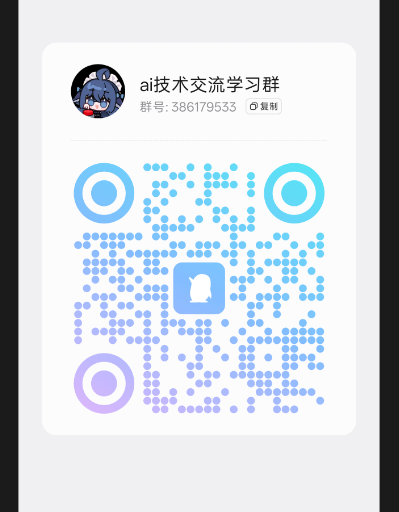

<div align="center">
  

# dsh-our-free-model

[简体中文](README.md) | [English](README_EN.md) | **日本語**

  
  
  
  
  
  <br>
  <a href="https://trendshift.io/repositories/261203"></a>
  <a href="https://trendshift.io/weekly?language=JavaScript"></a>
  <br>
  <sub>Trendshift JavaScript Weekly 1 位 · 2026 年 10 月 5〜11 日 · ランキング集計中（2026 年 10 月 11 日時点）</sub>

</div>

<div align="center">

> dsh にこのプラグインをインストールするだけです。ログインも、サインアップも、API キーも、
> その他の手順も一切ありません。DeepSeek V4.1 Flash や Kimi K3 をはじめとする
> 最先端のモデルがそのまま使えます。完全に無料で、利用上限もありません。
>
> 你只需在 dsh 里装上这个插件，无需登录、注册、填 API Key 或任何其它操作，就能用上包括
> DeepSeek V4.1 Flash、Kimi K3 在内的前沿模型——完全免费，不限量。
>
> モデルの一覧は上流に追従し、利用可否は**あなた自身の**ネットワークの出口から計測されます。
> 思考量の設定はプロンプトのヒントではなく実際のバジェットを送り、
> ローカルの OpenAI 互換転送ポートも付属しています。
>
> 純粋なプラグインとして組み込まれます：コアの変更なし、ビルド手順なし、依存関係ゼロです。

</div>

---

## コミュニティ

<div align="center">
  
  <br>
  <b>QQ グループ：386179533（ai技术交流学习群）</b>
  <br>
  QR コードを読み取るかグループ番号で検索して参加し、プラグインについての議論、問題の報告、ヒントの共有をしてください。
</div>

---

## ハイライト

- **設定は不要** — インストールして再起動し、モデルを選ぶだけです。アカウントも、キーも、登録が必要なクォータ管理画面もありません。
- **上流を明示** — 無料レーンは `https://opencode.ai` にある OpenCode の Zen ゲートウェイで、Kilo チャンネルは `https://kilo.ai` にある Kilo AI の公開ゲートウェイです。どちらにも直接接続し、通信を中継する第三者はいません。誰がリクエストを処理し、データがどこへ送られるのかは、[モデルの提供元](#モデルの提供元)と[免責事項](#免責事項)に詳しく書いています。
- **上流に追従するモデル一覧** — モデルの種類、コンテキスト長、機能は、プラグインに固定されるのではなく、更新のたびに取得し直されます。
- **ピッカーには実際に応答するものだけを表示** — 上流の一覧には載っているのに、ゲートウェイがルーティングをはっきり拒否するモデル（`Model is unavailable`、その id に対する 404）は、ドロップダウンから外れ、拒否の記録とともに設定ページに表示され続けます。モデルそのものについての判定では*ない*もの、つまりゲートウェイの 5xx、429 のクォータ期間、タイムアウト、接続の切断では、モデルは利用可能なままです。地域制限のあるモデルは専用の `region-limited` グループに移ります。ある回の確認ですべてが拒否された場合は何も隠さないので、ピッカーが空になることはありません。
- **ライブ配信付きのお知らせセンター** — リポジトリのオーナーが JSON ファイルを 1 つ編集して push すると、すべてのインストール先がポーリング 1 周期以内に受け取ります。本文は厳格な許可リストを通して描画される HTML で、`urgent` の項目は全画面のモーダルで開き、OS レベルの通知もオプションで使えます。
- **アプリ内アップグレード** — 設定ページでワンクリックするだけです：ダウンロード → SHA-256 の検証 → バックアップ → アトミックな置き換え → 読み戻しによる検証 → ホットリロード。どこかの手順が失敗すると自動でロールバックします。
- **ホットリロード** — アップグレードやコードの変更はアプリを再起動せずにすぐ反映されます。手動のボタンやオプションのファイル監視でも使えます。
- **出口ごとに地域を判定** — 地域で制限されているモデルは、会話の途中で失敗するのではなく、専用の `region-limited` グループに分けられます。ネットワークの出口を切り替えると、次の確認で自動的に分類し直されます。
- **ヘッダーではなく本文で判断** — 負荷がかかると、このゲートウェイはごく普通の SSE フレームのストリームを JSON の `Content-Type` 付きの 200 で返してきます。プラグインは先頭のバイトを嗅ぎ分けてストリームに戻すので、会話は捨てられずにストリーミングを続けます。また、ヘッダーが 1 つ嘘をついたせいで、動いているモデルが `unavailable` に格下げされることもありません。
- **確実に効く思考量の設定** — モデルの種類が 2 つあり、制御の方法も 2 つあります。思考レベルを宣言しているモデル（DeepSeek V4.1 Flash、GLM 5.3 Flash など）には専用のレベルメニュー（Off / Low / High / Max …）があり、選んだレベルはそのまま上流の `reasoning_effort` フィールドで送られます。このゲートウェイはこの値を検証するので、範囲外の値は 400 になります。レベルメニューのないモデル（MiMo V2.6 など）にはバジェットの段階があり、`Light / Balanced / Deep` はそれぞれ 2 048 / 8 192 / モデルの最大容量の出力トークンのバジェットに対応します。思考をオフにできないモデルでは、思考と目に見える回答が同じ上限を取り合うため、段階全体が 2 倍の 4 096 / 16 384 / 最大容量になります。どちらも呼び出しごとに記録され、設定ページの各モデルカードにはレベルか、実際に送る数値が表示されます（[思考量](#思考量レベルメニューまたはバジェットの段階)を参照）。
- **ブラウザの UI なしでも動作** — 必須の依存は `llm` だけなので、dsh-tui のようなヘッドレスの構成でもプラグインは有効になり、モデルを提供します。ダッシュボード側は独自の fiber で動き、`webServer` が現れた時点で自分自身をマウントするので、HTTP サーバーより先にプラグインを読み込む構成でも設定ページが使えます。利用可否の確認とバックグラウンドのループは普通のタイマーで動きます。
- **ローカル限定の利用状況ダッシュボード** — トークンのヒートマップ、合計またはモデル別の累積曲線、呼び出しごとに計測した出力速度と最初のトークンまでの時間を表示します。何もアップロードされません。
- **OpenAI 互換の転送ポート** — ベース URL と生成された API キーを使って、これらのモデルを他のローカルツールに公開できます。Chat の履歴にあるアシスタントの文字列型の `reasoning_content` フィールドは、明示的な空文字列も含めてツールの後続呼び出しのために保持されます。存在しないフィールドがでっち上げられることはありません。
- **EAC レーン** — DSHEAC AIO と、カーネルが宣言した `desktop`、`tauri`、`web`、`web-desktop` のプロファイル向けの共同負担レーンで、モデル名には `EAC` が付きます。認証情報は封印されており、ホストの受け入れとサーバー側の GitHub 認可（サインインしてリポジトリにスターを付けること）は別々の要件です。コマンドラインのプロファイル引数だけではアクセスは許可されません。
- **Kilo チャンネル（キー不要の無料プール）** — Kilo AI の公開ゲートウェイの無料モデルプール（一覧の `isFree` の部分をライブで取得し、自動ルーターの `kilo-auto/free` も含む）を内蔵しています。アカウントもキーも不要です。モデルカードには Kilo のバッジが付きます。思考量は EAC レーンと同じように動きます：モデル自身のレベルメニュー（Off / Low / Medium / High、デフォルトは High）があり、ゲートウェイの統一された `reasoning` パラメータを通して実際に送られます。Off で思考がゼロになることはファミリーごとに確認済みです（nemotron、ling、dots、poolside、apodex、cohere）。stepfun と liquid のエンドポイントは思考の無効化を拒否し（HTTP 400）、2 つの自動ルーターはこの設定を無視するため、これらのモデルのメニューには Off の段がありません。このプールは上流による無料の提供で、そのモデルカードには、サービス改善のためにプロンプトが記録される場合があると明記されています。機密性のある内容は決して送らないでください。[免責事項](#免責事項)を参照してください。
- **集約レーン — 自分のキーで 76 のプロバイダー** — 新しい設定タブで、サードパーティのエンドポイントを同じモデル一覧に取り込めます。レジストリには 76 のプロバイダーが含まれています（NVIDIA NIM、OpenRouter、Groq、Cerebras、SambaNova、Gemini、DeepSeek、Mistral、Together、Fireworks、SiliconFlow、Nebius、Chutes、Hugging Face、Cloudflare、Z.ai、Kimi、MiniMax、QwenCloud/Alibaba、Bedrock、Vertex、Vercel AI Gateway、Azure OpenAI、FleetRelay Gateway、さらにアカウント不要の Ollama、LM Studio、llama.cpp）。プロバイダーを設定すると（キーが必要なものはキーを入れます。アカウント不要のローカルのものは何も要りません）、そのモデルがそれぞれ `provider/model` の行としてピッカーとローカルゲートウェイに現れます。キーはローカルの `0600` の settings.json に保存され、API は `hasKey` と `…abcd` のフィンガープリントしか返しません。プロバイダーごとに、有効化／無効化、Test（*一覧取得*による確認で、生成を消費せずにキーを検証します）、Discover、ベース URL の上書き、モデル一覧の上書き、Remove ができます。OAuth/ADC のプロバイダーは一覧には載りますが、ここでは動かせないと表示されます。OpenCode のキー不要の無料プールは、意図的にレジストリの行には**していません**：リクエストごとに発行するセッション id、v2 クライアントの User-Agent、公式のツール宣言一式が必要で、このレーンの汎用的な通信方式にはそれらを載せる場所がありません。一覧に載せても決して応答しないピッカーの行が増えるだけで、その 10 個のモデルはプラグイン自身の無料レーンがネイティブに提供しています。
- **トークン節約機能** — 3 つあります。ツール出力の圧縮（RTK）は、リクエストを送る前に `tool_result` の内容をその場で書き換えます（git diff / status / log、grep、find、ls、tree、ビルドログ、行番号付きのファイルダンプ、検索結果の一覧、重複したログ行）。実測では、40 KB の `git diff` のバイト数が 90% 減っても、モデルはそれについて回答できました。プロンプトの整形には caveman と ponytail のファミリーがあり、どのレベルもデフォルトではオフです。さらに、プロバイダーを一切呼ばない 5 つのローカル回答があります。設定ページでは、利用状況のグラフと同じ統計の行から、圧縮前後のバイト数、節約率、圧縮したブロック数、計測した呼び出し数を表示します。
- **ルーティング（フォールバックチェーン）** — どのレーンのモデルも 1 つの名前付きチェーンにつなげられ、ピッカーとゲートウェイには仮想モデル `combo:<name>` として表示されます。`fallback` は常に先頭から始まり、`round-robin` は開始位置を順に回して N ターンの間そこにとどまります。*回答のデルタが 1 つも届く前に*失敗したリンクは丸ごと破棄されるので、切り替えは呼び出し側からは見えません。また、推論のデルタは意図的に内容として数えないので、「1 分考えたあとでクォータの壁に当たった」というケースこそがフェイルオーバーの出番です。
- **ローカルゲートウェイは Anthropic 形式をネイティブに話す** — 新しく `POST /v1/messages`（ストリーミングと非ストリーミングの両方に対応し、`thinking`/`tool_use` ブロック、実際の `stop_reason`、ヘッダー送信後に会話が失敗した場合のストリーム内の `error` イベントを含む）と `POST /v1/messages/count_tokens`（ローカルでの推定値。プラグインはトークナイザーを同梱していません）を追加しました。`/v1/models` は、集約レーンの行とチェーンも含めて、すべてのレーンを公開するようになりました。ゲートウェイページの新しい *Connect a client* セクションでは、実際にバインドしたポートと実際に必要なキーから、そのままコピーして使える設定例を生成します。Claude Code、Codex の `config.toml`、OpenAI と Anthropic の SDK、curl、そしてリレーが動いているときは LAN 用の例も作ります。
- **オプションの視覚効果** — 設定ページのヘッダーに Visual effects のスイッチがあり、デフォルトはオフです。アクアリウムとモデルの機能はそのまま使えます。オンにすると、背景の光、ガラスのぼかし、装飾的なアニメーションが戻ります。この設定は現在のブラウザに保存されます。
- **以前の 6 つに加えて全 11 タブ** — Free models、EAC models、Free channels、Dashboard、Request log、Gateway に、Aggregate、Token savers、Routing、Plugin upgrade、Recommended projects が加わりました。アニメーション（表示時のカードのせり上がり、タブ切り替え時のページのフェード、節約量メーターのアニメーション、ホバー時の浮き上がり）は `prefers-reduced-motion` を尊重し、パネルの幅では 1 列にまとまります。Recommended projects のページには、関連する 3 つのリポジトリ（EAC-Desktop、EAC-Pack、EAC-design-world）が、説明、直接のリンク、スターボタンとともに載っています。スター数、フォーク数、最終 push は GitHub からライブで読み込みます（GitHub に接続できない場合は表示せず、でっち上げることはありません）。
- **UI にきれいな名前** — 文字化けも、上流のベンダー文字列がモデルピッカーに漏れ出すこともありません。

## 利用できるもの

**コンポーザーのモデルピッカー**

| グループ | 内容 |
| --- | --- |
| `Our Free Model` | 現在のネットワークの出口から使えるモデル |
| `Our Free Model · region-limited` | 上流がこの地域では拒否するモデル。表示は残しつつ分けています |

ゲートウェイが名前を挙げているのにルーティングを拒否するモデルは、どちらのグループにも表示されません。
設定ページの **Not in the picker** に、拒否の内容と確認時刻とともに載り続け、
確認が通ればすぐに自動でピッカーに戻ります。

**設定ページ — `Settings → Our Free Model`**、7 つのセクション：

1. **モデル一覧** — モデルごとの利用可否、画像対応かテキストのみか、コンテキストウィンドウ、最大出力、思考量の各段で実際に送る出力の上限、実測した最初のトークンまでの時間、オンデマンドでの単発ベンチマーク。
2. **EAC レーンの認可** — ワンクリックの GitHub サインイン（ブラウザが処理するので、何も貼り付ける必要はありません）、サインインした名前とスターの判定結果、再確認ボタン、サインアウト。認可されるまでモデルカードにはロックが表示されます。無料レーンには影響しません。
2. **お知らせセンター** — オーナーが配信するフィード：未読カウンター、緊急度のバッジ、既読にする（個別／すべて）、今すぐ確認するボタン、OS 通知の切り替え。本文は許可リストを通して HTML として描画されます。
3. **利用状況ボード** — 主要なカウンター、17 週分のトークンのヒートマップ、トークン数とリクエスト数、合計と個別のモデルを切り替えられる累積曲線、速度のスパークライン、モデル別の表。
4. **ローカル転送** — 有効化／無効化、バインドするホストとポート、ベース URL のコピー、API キーの表示／コピー／ローテーション、すぐに実行できる `curl` の例。
5. **プラグインの設定** — マスタースイッチ、地域制限のあるモデルを公開するかどうか、確認の間隔、デフォルトの出力上限、検出した出口の IP と国。
6. **プラグインのアップグレード** — インストール済み／最新のバージョン、更新の確認、進捗と失敗の理由を表示するワンクリックのアップグレード、最後のアップグレードの履歴、ホットリロードのボタン、ファイル監視のスイッチ。

**初回起動時のお知らせ** — 5 ページのウォークスルー（前置き、モデル一覧、使い方、できること、ニュースとアップグレード）で、一度確認すれば、文面のバージョンが上がるまで二度と表示されません。

## インストール

> **⚠️ npm にある名前空間なしの `dsh-our-free-model` パッケージはインストールしないでください。**
>
> npm にある `dsh-our-free-model` パッケージは、**このリポジトリが公開したものではありません。**
> 第三者が再パッケージしたもので、中身はこのツリーと一致しません：
> `index.js` と `client.js` が改変されており、ここには一度も存在したことのない
> `src/channel-visibility.js` が含まれています。これをインストールすると、
> このプロジェクトがレビューしていないビルドが入り、このリポジトリが提供する署名付きマニフェストの
> 検証とアプリ内アップグレードも使えなくなります。
>
> このリポジトリが公開しているのは、名前空間付きの **`@ebony-vinyl/dsh-our-free-model`** で、
> リリースの `dsh-our-free-model-<version>.tgz` と同じツリー・同じバージョンからビルドしています。
> npm を使いたい場合は次のようにします：
>
> ```
> dsh plugin --profile web add @ebony-vinyl/dsh-our-free-model@2.8.0
> ```
>
> バンドル id には名前空間（`@ebony-vinyl/dsh-our-free-model`）が含まれるため、1 つのプロファイルの中で
> 下記の名前空間なしのローカルインストールと混ぜることはできません。どちらか一方を選んでください。
>
> 他の配布経路にある同じ名前のパッケージについては、
> このリポジトリを正とします。

### コマンドライン（通常の `dsh web`）

```bash
dsh plugin --profile web add /absolute/path/to/dsh-our-free-model
```

アプリを一度再起動してください。`--profile` には実際に使っているプロファイルを指定します。

### DSHEAC AIO / デスクトップ版 — まずお読みください

一部の DSHEAC AIO と古いデスクトップパックは、Web アプリを起動する前にプロファイルのゲートを実行し、
シンボリックリンクやディレクトリジャンクションを制限しています。このチェックのあるホストでは、次のように報告されることがあります：

```text
PROFILE_UPGRADE_REQUIRED: offline dependency migration is not yet available
```

このゲートが適用される場合は、`link:` の依存関係とジャンクションを避けてください。アプリ内の
プラグインマネージャーか、下記のローカル tarball の手順を使います。すべてのデスクトップシェルがこのゲートを
持つと決めつけず、実際のホストのログとインストールの取り決めに従ってください。

手動で実ディレクトリとしてインストールするには、信頼できるローカルの tarball を使います：

1. `<DSH_HOME>/profiles/<profile>/vendor/` を作成します。レビュー済みのリポジトリで `npm pack --ignore-scripts --pack-destination "<DSH_HOME>/profiles/<profile>/vendor"` を実行するか、このリポジトリの同じバージョンの公式リリース tarball をそこに置きます。ローカルでのパックは npm に公開されません。
2. プロファイルの `package.json` の dependencies に `"dsh-our-free-model": "file:./vendor/dsh-our-free-model-2.8.0.tgz"` を追加し、ホストのインストール手順で解決させます。ファイル名のバージョンはこのリポジトリの `package.json` と揃えてください。同じ名前の npm レジストリのバージョンで代用しないでください。
3. `dsh.profile.bundles` に `"dsh-our-free-model"` を追加します。

パッケージマネージャーがインストール済みのバイトを管理する場合は、バンドルの設定かプラグインの `settings.json` で `distribution: 'managed'` を設定します。そうするとパッケージマネージャーが更新を担当し、アプリ内アップグレード、お知らせのポーリング、ホットリロードは停止しますが、モデルへのアクセスは引き続き使えます。その後の更新では、信頼できる tarball を置き換えて依存関係のパスを更新し、古い lockfile が古いコピーを復元できないようにしてください。

リリースのファイルを手動でコピーする場合は、`adapter/`、`src/`、`locale/`、`vendor/magpie/` のメタデータとライセンス、そして `vendor/channel-pack/` の `pack.js`、WASM、LICENSE、NOTICE を含め、パッケージ全体をコピーしてください。エントリースクリプトだけをコピーすると、チャンネルの読み込みが不完全になります。

> `cordis.patch.yml` にエントリーを追加することは**しないでください**。`dsh.profile.bundles` から
> 参照されるバンドルは自身のパッチレイヤーをすでに適用しており、
> 二重に登録すると `duplicate loader entry id: our-free-model` で失敗します。

#### 統合パック（管理されたインストール）

プラグインが統合パック（EAC パック、Mojobox など）を通じて入る場合は、
*パック*が更新のタイミングとバイトを管理します：バンドルの設定で
`distribution: 'managed'` を指定してインストールする（または同じフィールドを settings.json に書く）と、
アプリ内のアップデーター、お知らせのフィード、ホットリロードはすべて停止します。1 つのインストール先に
書き込む者が 2 人いると壊れてしまうためです。モデルのレーンには影響しません。
受け入れテストは `scripts/offline-test.mjs` にあり、カタログ向けの記録
（manifest 0.15 / provenance / license / integrity）は `catalog/` にあります。

### デスクトップアプリを起動する前に確認する

やみくもに再試行するのではなく、デスクトップホスト自身のゲートをプロファイルに対して実行してください：

```bash
node -e "
const g = require('<APP_ROOT>/sidecar/dist/lib/profile-upgrade.js');
const app = '<APP_ROOT>', profile = '<DSH_HOME>/profiles/<profile>';
console.log(g.planProfileUpgrade(app, profile));
g.assertProfileStartup(app, profile);
console.log('startup gate: PASS');
"
```

`status: 'compatible'`、空の `mismatches` 配列、そして `PASS` が表示されるはずです。
起動せずにバンドルの構成だけを確認するには：

```bash
DSH_HOME=<DSH_HOME> dsh --profile <profile> --dump-config | grep our-free-model
```

`id: our-free-model` のエントリーが**ちょうど 1 つ**表示されるはずです。

### インストールの失敗：`ERR_PNPM_VIRTUAL_STORE_DIR_MAX_LENGTH_DIFF`

これは**プラグインのリポジトリではなく、対象プロファイルの pnpm の状態の問題**です（プラグインの
ダウンロードより前に発生します）。プロファイルの既存の `node_modules` は古い pnpm で作られており、
dsh を更新したあと、同梱の pnpm がそれを使い続けることを拒否します。
dsh を閉じ、プロファイルの `node_modules` と
`pnpm-lock.yaml` を削除して pnpm に作り直させてから、もう一度インストールしてください：

```bash
rd /s /q "%DSH_HOME%\profiles\web\node_modules"
del "%DSH_HOME%\profiles\web\pnpm-lock.yaml"
```

一緒に出る `Ignoring broken lockfile` の警告は、作り直すと消えます。

## デスクトップインストーラー（macOS、コミュニティビルド）

dsh プラグイン自体はビルド不要です。**デスクトップインストーラー**（Our Free Model のデスクトップシェル）は公式には Windows 版のみが公開されており、macOS のインストーラーはコミュニティビルドです。ソースの変更は [PR #421](https://github.com/Ebony-Vinyl/dsh-our-free-model/pull/421) にまとまっており、1 行ずつすべて監査できます。ビルド済みの Apple Silicon（arm64）版はその PR とコミュニティのリリースから入手できます。Mac で自分でビルドすることもできます（`npm --prefix packages/desktop run build`。パイプライン全体は `.github/workflows/build-macos.yml` にあります）。

ダウンロード後にチェックサムを確認してください（SHA256 は PR / リリースに記載されています）：

```bash
shasum -a 256 ~/Downloads/Our.Free.Model_<version>_aarch64.dmg
```

**「このアプリは壊れています」と表示される、または開かない場合**

コミュニティビルドは Apple Developer アカウントでの署名や公証を受けていないため、初回起動時に Gatekeeper がブロックします。ファイルが実際に壊れているわけではありません。次のいずれかを試してください：

1. **右クリックで開く**：Finder でアプリのアイコンを Control キーを押しながらクリックし、**開く**を選んでから、ダイアログでもう一度**開く**を選びます。
2. **隔離属性を削除する**（ターミナル）：

   ```bash
   xattr -cr /Applications/Our\ Free\ Model.app
   ```

3. **それでも壊れていると表示される場合は、sudo で隔離属性を削除する**（新しい macOS は未署名のアプリにより厳しくなっています）：

   ```bash
   sudo xattr -rd com.apple.quarantine "/Applications/Our Free Model.app"
   ```

4. **システム設定で許可する**：**システム設定 → プライバシーとセキュリティ**を開き、**このまま開く**ボタンが表示されていればクリックします。

注意事項：

- 現在のコミュニティビルドは **Apple Silicon（arm64）** 用です。Intel Mac ではソースからビルドしてください。
- バンドルには独自の Node ランタイムとスタンドアロンのサービスが含まれています。ログインも API キーも不要です。
- パッケージは Apple による署名や公証を受けていません。信頼の根拠は、上記の監査可能なソースの変更と再現可能な CI のビルド記録だけにしてください。

## 使い方

**モデルを選ぶ。** コンポーザーのモデルセレクターを開き、`Our Free Model` の下から
好きなものを選びます。選択はセッションごとに保持されます。

**思考の深さを変える。** 同じメニューに `Effort` があり、`Light`、
`Balanced`、`Deep` を選べます。レベルが高いほど出力バジェットの多くを
熟考に使います。上限はリクエストに対して適用されるので、違いは見た目だけでなく
実際に計測できます。
熟考と目に見える回答で共有する上限は**1 つ**だけです。そのため、
思考をオフにできないモデルでは段階全体が 2 倍になります（`Settings → Our Free Model` の
モデルカードに、各段で実際に送る数値が表示されます）。回答が途中で切れ続ける場合は、
`Deep` に変えるか、設定で呼び出しごとの出力上限を上げてください。

**他のローカルツールに提供する。** `Settings → Our Free Model → Local forward` で
有効にし、ベース URL をコピーしてキーを生成します。対応しているルート：

```text
GET  /v1/models
POST /v1/chat/completions        streaming and non-streaming
POST /v1/responses
POST /v1/messages                streaming and non-streaming (Anthropic Messages)
POST /v1/messages/count_tokens   local estimate; the plugin ships no tokenizer
```

別のプログラムがポートを使っている場合でも、リスナーは止まりません。同じポートを数回再試行し
（閉じたばかりのリスナーや、削除したばかりの portproxy のルールは、数百ミリ秒以内にポートを
解放します）、それから次の空きポートに移り、設定ページにそのことを表示します。
*requested 18899 is not available, listening on 18900* のように表示され、
設定に書き戻されるポートは実際のものです。
Windows で最もよくある使用者は `netsh interface portproxy` のルールです（IP
Helper が提供）。その `0.0.0.0` 上のリスナーのせいで、ループバックへのバインドは `EADDRINUSE` ではなく
`EACCES` で失敗します。`netsh interface portproxy show all` でルールを一覧でき、
`netsh interface portproxy reset` で消去できます。

転送エンドポイントは完全にストリーミングします。`data:` フレームに加えて、思考中の
レーンは定期的に SSE のコメントフレーム（`:` の行）を受け取るので、クライアントのアイドル
タイムアウトが「上流はまだ考えている」を「ソケットが死んでいる」と誤解することはありません。
思考は `reasoning`、`reasoning_content`、`reasoning_text` の下で認識されます
（同じ思考を 2 つのフィールドで繰り返すゲートウェイでも 1 回として数えます）。
`reasoning_details` 配列も同様です。上流で思考がストリーミングされないモデルでは、
ここでも推論のフレームは送られません。
[既知の制限](#既知の制限)を参照してください。

**ネットワーク上の他のデバイスに提供する。** 同じパネルに *Network
access* のセクションがあります。デフォルトはオフです。オンにすると、リレーはルーティング可能な
アドレス（デフォルトは `0.0.0.0`）にバインドし、**専用のキー**を要求します。このキーは
ローカルのキーとは別なので、どちらかが漏れてもその側のキーをローテーションするだけで済み、
ローカルのポートにつないであるツールは何も気づきません。リレーはローカルのリスナーに
転送し直すので、モデル一覧、ストリーミング、エラーの意味はローカルのポートと
同じです。ポートに `0` を指定すると「自動で選ぶ」という意味になります（他のものを動かしているマシンでは
18899 がすでに使われていることがよくあります）。
パネルには、最終的に決まったポートとネットワークアドレスが表示されます。オンの間は、
このマシンに到達できる人なら誰でもそのキーで無料クォータを使えます。信頼できる
ネットワークでだけ有効にし、可能であればファイアウォールで接続元を絞ってください。

**プロキシの出口を通してリクエストを送る。** `Settings → Our Free Model → Egress
proxy`。オプションで、デフォルトはオフです。オフのときは直接接続します。モードは 2 つです：

- **サブスクリプションモード**：Clash/V2Ray のサブスクリプション URL を貼り付けます。プラグインは
  ローカルで mihomo を起動し（自動検出します。たとえば Clash Verge の `verge-mihomo.exe` です。
  パスを自分で指定することもできます）、5 分ごとに計測し直す url-test グループを内蔵していて、
  最も速いノードに通信を送り、死んだノードはヘルスチェックで外します。
  **サブスクリプション URL は認証情報として扱います**。サブスクリプションの
  リンクのパスそのものが*トークン*だからです。そのため、2 つの転送用キーと同じ基準で扱われます：
  ローカルの設定ファイルに保存され、リクエストと一緒に送られることはなく、
  設定のペイロードで返されることもありません。パネルにはマスクしたホストだけが表示され
  （`https://host/…`）、「Show」と「Copy」は設定ページ自身から値を取得します
  （`GET /egress/url`）。入力欄が空なら「保存済みのアドレスを維持する」という意味で、
  「Clear」はアドレスを削除し、同時に出口も停止します。
- **単一プロキシモード**：`http://` / `https://` / `socks5://` /
  `socks5h://` のプロキシアドレスを入力すると、処理するすべてのリクエストがそれを経由して接続します。

**保存時の扱い。** mihomo はそのアドレスを設定ファイルから読む必要があります（プラグインは
使い捨ての `mihomo.yaml` をデータディレクトリに書き、そこから mihomo を起動します）。
そのため、ディスク上のコピーは平文のままです。
この扱いで防げるのは、ペイロードでの返送、ログの行、画面の盗み見であって、
同じマシン上の別のプロセスではありません。

引き継ぐ通信は 3 種類だけです：モデルの推論、モデル一覧の取得、
出口 IP の確認です。お知らせ、アップグレード、EAC レーンは直接接続のままなので、
サブスクリプションの身元がリリースの経路に混ざることはありません。

**範囲。** この出口が扱うのはこのプラグインの opencode の通信だけで、
このマシン上の他のものは扱いません。起動される mihomo は、プラグイン専用の使い捨ての設定で動きます：
`bind-address: 127.0.0.1` と `allow-lan: false`、`tun:` セクションなし、
システムプロキシなし、システムレベルのプロキシ登録なし、仮想アダプターなしです。
リスナーは一時的な空きループバックポートです。ブラウザ、シェルのツール、その他の
IDE 拡張機能がこれを経由することはありません。経路が変わるのは、このプラグインが
opencode ゲートウェイに送るリクエストだけです。単一プロキシモードも同じ仕組みで、書き換えは
プラグインの内部で行われます。

**ライブの状態表示。** 出口がオンの間、設定ページにはその下に 3 行が追加されます：
現在の出口（マスクしたホスト · モード）、**最良のノード**（url-test が
選んだノードと、その順位を決めた遅延）、**opencode へのアクセス**（最後の
モデル一覧取得の往復時間を秒で表示）です。ノードと遅延は読み取り値で、mihomo 自身の
コントローラーに問い合わせて 15 秒ごとに更新されます。読み取り値がないときは
「measuring…」と表示され、外向きの通信には影響しません。

**できることとできないこと**：IP ごとのレート制限と地域のゲートは
出口に連動して変わりますが、セッションごとのレート制限とフィンガープリントのゲートは、
どの出口を使っても関係ありません。出口を切り替えると自動で確認し直します。起動直後の出口は
通信を運べるようになるまで数秒かかるので、プラグインは新しい出口が応答するのを
待ってからグループ分けをし直し、地域制限のあるモデルが新しい出口に追従するようにします。
下記の Reprobe でも、必要なときに同じことができます。

**地域を確認し直す。** `重新探测可用性`（Reprobe）は、現在の出口に対して
利用可否の確認をやり直します。VPN を切り替えて確認し直すと、地域制限のあるモデルは
2 つのグループの間で自動的に移動します。

**お知らせを受け取る。** すべて自動です：オーナーが push すると、
動作中のインストール先がポーリング 1 周期以内（デフォルトは 30 分、
*Check for new announcements* を使えばすぐ）に項目を取り込みます。通常の項目は
トーストを表示し、`urgent` の項目は全画面のモーダルを開き、どちらも未読の印付きで
お知らせセンターに入ります。そこで *OS notifications* を有効にすると、
システムレベルのトーストも表示されます。

**プラグインをアップグレードする。** `Settings → Our Free Model → Plugin upgrade` →
*Check for updates* → *Upgrade now*。一連の流れはすべてアプリ内で動きます
（ダウンロード → 検証 → バックアップ → 置き換え → ホットリロード）。再インストールも再起動も不要です。
アップグレードが失敗すると前のバージョンに戻し、その理由を報告します。

## 集約レーン、トークン節約、ルーティング、ローカルゲートウェイ

### 集約レーン：76 のプロバイダーに自分のキーを持ち込む

**Aggregate** タブで、サードパーティのエンドポイントを同じモデル一覧に取り込めます。プロバイダーのレジストリには 76 のエントリーが含まれています（`src/providers/registry.json`、`free | free-tier | apikey | oauth | local` に分類）：NVIDIA NIM、OpenRouter、Groq、Cerebras、SambaNova、Gemini、DeepSeek、Mistral、Together、Fireworks、SiliconFlow、Nebius、Chutes、Hugging Face、Cloudflare、Z.ai、Kimi、MiniMax、QwenCloud/Alibaba、Bedrock、Vertex、Vercel AI Gateway、Azure OpenAI、FleetRelay Gateway、そしてアカウント不要のローカルのもの（Ollama、LM Studio、llama.cpp）です。データは free-claude-code のプロバイダーカタログ、9router のプロバイダーレジストリ、そしてこのプロジェクトが追加したカスタムゲートウェイに由来します。FleetRelay Gateway は現在 `deepseek-v4.1-flash-free` と `gpt-6-astra` を公開しています。そのサードパーティの T1 候補は、配布の許可が出るまで無効にしています。

プロバイダーを設定すると（キーが必要なものはキーを入れます。アカウント不要のローカルのものは何も要りません）、そのモデルがそれぞれ `provider/model` という名前のカタログの行になり、モデルピッカーで選べて、ローカルゲートウェイからも呼び出せます。どのように提供するかは、プロバイダー自身の通信形式で決まります：OpenAI Chat Completions、OpenAI Responses、Anthropic Messages のいずれかです（後の 2 つは、それしか話さないプロバイダー向けです）。

キーはプラグイン自身の `0600` の `settings.json` にだけ保存され、API がそれを返すことはありません：ページには `hasKey` と `…abcd` のフィンガープリントが表示されます。フィールドがなければ保存済みのキーを維持し、空文字列ならキーを消去します。プロバイダーごとに、有効化／無効化、Test ボタン、Discover ボタン、ベース URL の上書き（使えるデフォルトがない Azure、Cloudflare、Vertex では必須）、モデル一覧の上書き、Remove があります。Test は*一覧取得*による確認です。生成を消費せずにプロバイダーのモデル一覧を通してキーを検証し、プロバイダーが一覧を宣言していない場合はそう伝えます。認証が OAuth または ADC（Google ADC）のプロバイダーは、このレーンではそれらの手順を完了できないため、一覧には載りますが、ここでは*動かせない*と表示されます。

### トークン節約：ツール出力の圧縮、プロンプトの整形、ローカル回答

**ツール出力の圧縮（RTK）** は、リクエストを送る前に `tool_result` / `role:"tool"` の内容をその場で書き換えます：git diff、git status、git log、grep、find、ls、tree、ビルドとパッケージマネージャーのログ、行番号付きのファイルダンプ、Cursor の検索結果の一覧、重複したログ行の連続です。実測では、40 KB の `git diff` のバイト数が 90% 減っても、モデルはその差分について回答できました。安全のためのルールは次のとおりです：エラーのツール結果には決して手を触れない、一定のサイズに満たない本文はそのままにする、置き換えた結果が入力より大きくなることはない、例外を投げたフィルターは元の内容をそのまま通す、そして処理は冪等です。ローカルゲートウェイを含むすべてのレーンに適用され、デフォルトでオンです。

**プロンプトの整形** には、レベル付きの 2 つのファミリーがあります。`caveman`（簡潔な返答：`off/lite/full/ultra/wenyan-lite/wenyan/wenyan-ultra`）と `ponytail`（YAGNI に沿った最小限の返答：`off/lite/full/ultra`）です。アシスタントの話し方を変えるので、どのレベルも最初は `off` です。注入は冪等で、形式を考慮します（chat ではシステムメッセージ、Anthropic ではブロック配列の形式も含めて `system` に入れ、最後の `cache_control` の前に挿入します。Responses では `instructions`/入力アイテムです）。また、元に戻せます。

**節約量のダッシュボード** には、圧縮前 → 圧縮後のバイト数、節約したバイト数、割合、圧縮したブロック数、計測した呼び出し数が表示されます。利用状況のグラフと同じ統計の行から読み込んでいます。

**5 つのローカル回答**（free-claude-code から移植。それぞれ個別に切り替えられ、デフォルトではすべてオン）は、プロバイダーを一切呼びません：クォータの確認（`max_tokens:1` と「quota」→ `Quota check passed.`）、シェルコマンドのプレフィックス検出（`<policy_spec>` と `Command:` → プレフィックス。コマンドインジェクションは拒否します）、セッションタイトルの生成（→ `Conversation`）、提案モード（→ 空文字列）、ファイルパスの抽出（→ `<filepaths>` ブロック）です。ローカルゲートウェイはこれらにプロセス内で回答します。

### ルーティング：名前付きのフォールバックチェーン（combo）

すべてのレーンにまたがるモデル id の、名前付きで順序のあるリストで、ピッカーとゲートウェイには `combo:<name>` という仮想モデルとして表示されます。戦略は 2 つあります：`fallback`（常に先頭から始める）と `round-robin`（開始位置を順に回し、N ターンの間そこにとどまる）です。チェーンは、どれかが出力を返すまでリンクをたどります。*内容のデルタが 1 つも届く前に*失敗したリンクは丸ごと破棄されるので、切り替えは呼び出し側からは見えません。推論のデルタは意図的に内容として数えません。「1 分考えたあとでクォータの壁に当たった」こそが、フェイルオーバーする価値が最も高いケースだからです。回答のデルタが一度届いたあとは、その後の失敗は通常どおり会話を終わらせます（単一モデルのチェックポイントからの回復は、その前に続きの試行を行います）。能力はリンクの共通部分になり（すべてのリンクが画像に対応している場合にだけ、チェーンは画像対応を公開し、コンテキストウィンドウは最小のものになります）、すべてのリンクが現在利用できないチェーンは、黙って捨てられるのではなく、保存されたうえで使用不可と表示されます。

### ローカルゲートウェイ：ネイティブな Anthropic の窓口と接続設定例

新しいエンドポイントが 2 つあります：`POST /v1/messages`（ストリーミングと非ストリーミングの両方に対応し、正しい `message_start` / `content_block_*` / `message_delta` / `message_stop` のフレーミング、`thinking` ブロック、`tool_use` ブロック、実際の `stop_reason`、ヘッダー送信後に会話が失敗した場合のストリーム内の `error` イベントを含む）と `POST /v1/messages/count_tokens`（文書化されたローカルでの推定値。プラグインはトークナイザーを同梱していません）です。そのため、Claude Code と Anthropic の SDK をそのままプラグインに向けられます。既存の `/v1/chat/completions` と `/v1/responses` は変わっておらず、`/v1/models` は、集約レーンの行とチェーンも含めて、すべてのレーンを公開するようになりました。ゲートウェイページの新しい *Connect a client* セクションでは、実際にバインドしたポートと実際に必要なキーから生成した、そのままコピーできる設定例を表示します：Claude Code の環境変数、Codex の `config.toml`、OpenAI SDK、Anthropic SDK、curl、そしてリレーが動いているときは LAN 用の例です。

その過程で、誤った成功が 1 つ修正されました：出力が、呼び出し側が宣言していないツールの呼び出しだけだった会話は、以前はきれいな空の成功として返されていました。現在は何が起きたかを報告します。トークン節約機能自身の `[full diff: rtk git diff --no-compact]` というヒントによって、モデルが呼び出し側の持っていないツールを要求することがあるためです。

## 仕組み

```text
index.js      host half: adapter registration, catalog + availability probes,
              settings/stats stores, webServer API routes, forward lifecycle,
              announcement / upgrade / hot-reload wiring
adapter/      kernel seam: the only module in the package allowed to import
              @deepseek-ai/* (kernel.js: attribution User-Agent with a literal fallback)
src/adapter.js  structural LlmAdapter: providerInfo, listModels, resolveModel,
                prepareCall, stream, providerRetryPolicy
src/upstream.js gateway identity: credentials, session/request id minting,
                tool fingerprint, endpoint selection per wire
src/stream.js   three wire decoders (chat / messages / responses) normalised to
                harness StreamChunks, with disjoint token accounting
src/messages.js harness messages -> wire shapes, plus tool-pairing repair
src/effort.js   effort level -> output budget
src/forward.js  standalone OpenAI-compatible listener (plus the Anthropic Messages endpoints)
src/providers/registry.json aggregate-lane registry: 76 providers, category, auth, wire
                format and endpoints
src/providers/index.js registry access and provider/model composite id parsing
src/aggregate.js aggregate lane: catalog rows, credential resolution, key redaction,
                listing probes, per-wire posting
src/anthropic.js Anthropic Messages codec for /v1/messages, plus the local token estimate
src/token-saver/index.js compaction pipeline: prompt injection -> tool-output compaction,
                byte accounting, fail-open
src/token-saver/inject.js idempotent injection and stripping on the chat / messages /
                responses wires
src/token-saver/prompts.js the caveman and ponytail prompt families and their levels
src/token-saver/rtk/ tool-output filters: git diff/status/log, grep, find, ls, tree,
                build logs, numbered dumps, search listings, duplicate log lines
src/local-optimize.js the five local answers: quota, prefix, title, suggestion, filepath
src/combos.js fallback chains: virtual catalog rows, two strategies, intersected capacities
src/route/classify.js one failure vocabulary and cooldown policy for every lane
src/trust.js    request trust fence for the plugin's routes (connection bridge
                + structural fallback)
src/push.js     SSE push hub: arrivals, update availability, upgrade done
src/feed.js     remote announcement feed: multi-source fetch, validation, cache,
                arrival detection
src/updater.js  in-app upgrade: manifest validation, SHA-256 checks, backup,
                atomic replace, rollback
src/reload.js   self hot reload: mirrors the kernel HMR sequence (cache purge,
                re-import, re-register, rollback)
client.js       browser half: hand-written ModuleLoader bundle, no build step
```

知っておくとよい設計上の判断：

- **1 つのアダプター、2 つのプロバイダールート。** ハーネスはモデルピッカーを厳密にプロバイダールートでグループ分けし、カタログの通信形式にはグループ／タグ／バッジのフィールドがありません。そのため、別の `region-limited` の見出しを表示するには 2 つ目のルートを公開するしかありません。また、クライアントは空のグループを捨てるので、地域による制限がなくなれば 2 つは自動的に 1 つにまとまります。
- **構造的なアダプターで、`@deepseek-ai/dsh-llm` はインポートしない。** カーネルは `instanceof` を一切確認しないので、アダプターはダックタイピングで作られています。これにより、プラグインが特定のカーネルのバージョンに縛られずに済み、同じコードが 0.1.5 と 0.1.7 の両方で動きます。
- **設定の仕組みではなく独自の JSON ストア。** 設定の登録 API はカーネルによって異なります。`DSH_HOME` の下にある専用の JSON ストアならどちらでも同じように動き、転送用のキーを、共有の設定ドキュメントに決して入らない `0600` のファイルに保存できます。
- **トークン節約機能は唯一の集約点で動き、失敗しても通す。** プロンプトの注入とツール出力の圧縮は、他のすべての変更（フィンガープリントの名前変更、思考量のパッチ、封印されたレーンのペース調整のヒント）が適用されたあとに、`payloadFor()` で動きます。ここは、アダプター自身の送信と、アダプターを通して呼び出すローカルゲートウェイの両方が通る唯一の場所なので、すべてのレーンとすべての回復セグメントが圧縮されます。どの手順も失敗したら通します：例外を投げた節約機能は飛ばし、例外を投げたフィルターは元のテキストをそのまま通し、認識できない本文の形はそのままにします。安くするためのもののせいでリクエストが失敗することは、決してあってはなりません。
- **combo は仮想的なカタログの行なので、フェイルオーバーはアダプターで解決する。** チェーンは `channel:'combo'` と実際のモデル id のリストとして統合カタログに加わります。だからこそ、ピッカーはそれを公開し、ゲートウェイは他の行と同じように名前で呼び出せます。チェーンはアダプターの `runStream()` の中で展開されて次へ進むので、どちらの呼び出し側もフェイルオーバーについて知る必要はありません。

### 思考量：レベルメニュー、またはバジェットの段階

モデルの種類が 2 つあり、制御の方法も 2 つあります。

思考レベルを宣言しているモデル（一覧に `effort.values` を含む `reasoning_options` がある）には
**レベルメニュー**があります：選んだレベルはそのまま上流の `reasoning_effort` フィールドで
送られます。EAC レーンと Kilo レーンと同じ形です。
これは 2026-10-17 に確認し直した結果です。2026-09-24 の時点では、このレーンはフィールドを
無視していましたが、現在は値を**検証**します：範囲外の値には、受け付ける値の一覧を示した
`400 invalid_value` が返り
（`none|minimal|low|medium|high|xhigh|max`）、推論の量も実際にレベルに応じて
変わります（`deepseek-v4.1-flash-free`、3 回のサンプルの中央値：
none 0、low 793、high 700、xhigh 1405、max 1906）。そのため、メニューにはそのモデルが宣言する
レベルだけを表示します。値の一覧にオフの段がないモデル（GLM 5.3 Flash は
`none` にしても実際には思考が止まりません）には、オフの段を付けません。

レベルメニューのないモデル（一覧が `toggle` か `budget_tokens` だけ、
あるいは `reasoning_options` がまったくない）は、**バジェットの段階**のままです：
思考量は出力トークンの厳格な上限で、これは確かに効きます。記録された推論の
トークン数はレベルに応じて単調に増えます。上流が表現できない段をでっち上げれば、
モデルが一度も持ったことのない能力を主張することになってしまいます。

ウィンドウと出力の上限は 9router / models.dev の慣例に従います
（`limit.context` / `limit.output`、`modalities.input`）。上流の一覧が
公開しているのは id だけです。

### デバッグに実際に時間を取られた 3 つのカーネルの挙動

どのプロバイダープラグインでもはまるはずなので、ここに記録しておきます：

1. **`providerRetryPolicy()` はそのまま保存される。** どちらのカーネルもこれを解決せず、
   バックオフのスケジューラーは `initialDelayMs / maxDelayMs / jitterRatio` を
   **最上位**から読みます。これらを `backoff` の下に入れて返すと `undefined * 2ⁿ =
   NaN` になり、永続的なセッションログは有限でない数値を拒否します。そのため、回復できるはずの
   一時的な失敗が、中断された会話になってしまいます。解決済みのフラットなポリシーを返してください。
2. **中断されたツール呼び出しが 1 つあると、セッション全体が壊れる。** 対応する結果のない
   ツール呼び出しは `400 invalid_request_error` として再生され、それ以降はそのセッションの*すべての*
   リクエストが失敗します。プラグインは、3 つの通信形式のすべてで、送信前に
   対応関係を修復します。
3. **`inject` で名前を挙げていないサービスはプロパティとして読むと例外を投げ、
   まだ提供されていないだけのサービスには `ctx.get()` が `undefined` を返す。** 今回は
   その両方にはまりました：`inject` を `['llm']` に減らしたあと、`typeof ctx.interval ===
   'function'` が `cannot get property "timer" without inject` を投げ（`ctx.interval` は
   `timer` サービスの上の mixin です）、プラグインは*どの*構成でも有効にならなくなりました。
   そこを `ctx.get('webServer')` に切り替えると、今度は `undefined` が返りました。
   構成に Web サーバーがなかったからではなく、ブラウザ側がそれを公開する前にプラグインが
   読み込まれるからです。そのため、設定のルートは登録されず、アプリの提供で忙しいサーバーの裏で、
   ダッシュボードにはデータの取得元がありませんでした。
   うまくいく形は `ctx.inject(deps, callback)` です：
   必要なサービスに専用の fiber を与えて*それ*に待たせ、読み込み時に一度だけ
   推測するのはやめましょう。

### レスポンスを `Content-Type` ではなく本文の形で読む理由

負荷がかかると、このレーンは普通の SSE フレームのストリームを `application/json` 付きの 200 で返します。
ヘッダーを信じると、`await response.text()` がライブのストリームを飲み込み、
`JSON.parse` が失敗して、会話が失われていました。しかも、そのエラーは
`status: 200` を持っていたため、利用可否の確認はまったく問題なく動いているモデルを
ルーティング不能と判断し、1 回分ピッカーから外していました。現在は先頭のバイト（4 KB 以下）を
嗅ぎ分けて分類し、それからストリームに戻すので、何もバッファーされず、
トークンが遅れて届くこともありません。判別を行うのは `src/http.js` の `sniffBody` だけです。

### 速度パネルに `—` と表示される理由

初期のビルドは、実際には約 40 tok/s のレーンについて 2 941 tok/s と表示していました。
ゲートウェイのせいではありません。生の読み取りによる確認では、5.6 秒にわたって 64 フレームが届いていました。
問題は、分子と分母が異なる区間を表していたことです：ある呼び出しでは 422 の
出力トークンが課金され、そのうち 291 は**1 フレームもストリーミングされなかった**推論でしたが、
それでも計測の区間は最初の目に見えるトークンから始まっていました。生成全体を
回答のテキストにかかった秒数で割っても、デコードの速度にはなりません。

そこで、速度は、それを計算できるだけの区間がある場合にだけ表示します：`windowTokens()` は
ストリーミングされなかった推論のトークンを分子から除き、`decodeWindow()` は
計測するには短すぎる区間と、現実にしては速すぎる速度を退けます。パネルと
モデル別の表はどちらも、呼び出しごとの比率を平均するのではなく、トークンの合計を秒数の合計で割ります。
1 ミリ秒の区間が 1 つあるだけで、26 回の呼び出しの平均が 3 桁も
変わってしまったからです。そのため、回答が 2 フレームで届くモデルには計測できる
出力速度がなく、そのように表示されます。

### 長い推論のストリームが切れたあとの自動回復（issue #12）

すべてのモデルで、上限付きの回復の試行が 1 回、デフォルトで有効になっています。対象は Chat
Completions、Messages、Responses の上流プロトコルです。条件は、最初の
ストリームが空でない推論を届け、回答のテキストもツール呼び出しもなく、そのうえで
正常な終端フレームなしに EOF に達したか、回答のテキストがなく推論だけを含む正常な `stop`
終端を受け取ったことです。
つまり、ホストが空のレスポンスと判断するような会話が対象です。
キャンセル、すでに回答のテキストやツール呼び出しを届けた正常な終了、出力の上限、上流からの明示的な
エラーでは、回復は行われません。

プラグインは、元の入力と受け取った推論をテキストのチェックポイントとして含む**新しいリクエストを 1 つ**送り、
直接回答するよう求めます。これは
上流のネイティブな再開ではなく、すでに表示された推論が再生されることもありません。
回復のリクエストではツールは無効になります。回答のテキストやツール呼び出しが始まったあとの
切断は、内容や実行の重複を避けるために回復しません。

長い推論がもう一度繰り返されるのを避けるため、続きのプロンプトは、まず
結論を、最大 800 語で示すよう求めます。これはプロンプトでの指示であって、トークンの厳格な
上限ではないので、モデルが無視することもあります。回復は質を落とした回答です：
もとのリクエストが長い分析や段階的な分析を求めていた場合は、短くなることがあります。

1 つの論理的な会話で行う物理的なリクエストは最大 2 回です：元のリクエストと 1 回の
回復です。デフォルトの全体の期限は 900 秒（15 分）で、回復には
残りの全体時間の範囲内で最大 300 秒が割り当てられます。回復の出力は
8192 トークンが上限で、ユーザーとモデルの上限にも従います。最初のセグメントで
わかっている出力トークンは元のバジェットから差し引かれ、
残りが 512 トークン未満なら回復は始まりません。チェックポイントは
131072 文字までに制限され、コンテキスト容量についての、テキストのバイト数による
控えめな推定を通過する必要があります。
この推定は画像のトークンを数えず、正確なトークナイザーによる確認でもありません。
上限を超えると回復は止まります。成功するには、空白だけではない回答の
テキストを伴う正常な終了が必要です。回復に失敗すると `STREAM_CUT` を返し、
ハーネスはこれを会話全体として送り直しません。ユーザーによるキャンセルは
`aborted` / `ABORTED` のままです。

無効にするには、ローカルの settings.json で `streamRecovery: false` を設定します。
オブジェクトを指定して、`enabled` のスイッチとより小さい数値の上限を与えることもできます。上限は
デフォルトを超えられません。モデルの許可リストはありません。

ローカルのダッシュボードでは、**物理的なリクエスト**と**論理的な会話**を分けて扱います。
上流へのリクエストとリクエストの失敗は、実際に送った HTTP リクエストを 1 つずつ数えます。
会話のターン、ターンの失敗、回復したターンは、アダプターの 1 回の
呼び出しを最終的な結果で数えます。そのため、最初のセグメントが途中で切れて
続きが成功した場合は、上流へのリクエストが 2、リクエストの失敗が 1 と表示される一方で、
会話のターンは 1、ターンの失敗は 0、回復したターンは 1 のままです。
各セグメントには、回復の識別子、試行の番号、
`noUsage` の印を持つ独自のサンプルが残ります。共通の `recoveryId` がそれらの印を結び付け、
欠けている使用量を特定します。ハーネスに送る最終的な使用量は、上流が
実際に報告した数だけを合計します。いずれかのセグメントに使用量の報告がなければ、それは
会話全体のトークンの合計ではありません。推論のチェックポイントは統計の
ファイルには書き込まれません。

アップグレード前の履歴には物理的なリクエストの記録しかないため、移行したターン数と
失敗数は推定値で、ダッシュボードにはそのように表示されます。アップグレード後に記録された
ターンは最終的な結果を使うので正確です。
リクエスト、ターン、トークンの合計は累計値です。速度、最初のフレーム、
ヒートマップの詳細は、ローカルに保持している履歴の期間を使います。

MiMo V2.6 Flash · Deep の実際のリクエストが 1 件、回復に成功しました。それより前の
試行は 480 秒の期限で失敗しています。これは、すべてのモデルを実環境で確認できたことや、
すべての長い推論の会話が完了することを保証するものではありません。下記の
v1.3.1 の記録は、回復機能を追加する前の挙動を表しています。

## 検証

Windows で、実際の上流に対してテストしています。表はリリースの回ごとに分けて残しており、
各行にはどの方法で確認したかが書かれています。*live upstream*
または *hands-on* と記した行だけが、ユーザーがインターフェースで目にする挙動です。

### Issue #12：検証の状況

実装、オフラインの回帰テスト、実環境での結果は、
[`docs/issue-12-recovery.md`](docs/issue-12-recovery.md) で別々に追跡しています。回復 99/99、
切り詰め 35/35、新しいフィンガープリントの確認 11 件、型チェックがすべて通っています。12 の
確認では、ローカルの HTTP 越しに実際のプラグインを使い、転送の成功、失敗、
クライアントの切断、保存された統計を検証しています。技術的な記録には、
テストスイート全体の最終結果が載っています。MiMo Deep の実際の実行では、最初の
ストリームが 304.161 秒で自然に EOF に達し、回復には 32.777 秒かかって、
4264 文字の回答テキストを生成し、`stop`、使用量、`[DONE]` で終わりました。
リクエストは 2 回で、合計 336.942 秒でした。最初のセグメントには使用量の
報告がなかったため、まとめにはわかっている数だけが含まれています。それより前に失敗した
480 秒の試行は、技術的な記録に残っています。実際の dsh の UI と他の
モデルは、個別には受け入れ確認をしていません。

### 過去の記録：v1.3.2（issue #11、#13、#19、#20、#21）

| 項目 | 修正 | 検証 |
| --- | --- | --- |
| #19 自己アップデートの信頼チェーン | Ed25519 で署名したマニフェスト（公開鍵はプラグインに固定し、秘密鍵はリポジトリの外に置く）、更新の経路を `feedUrl` から完全に切り離す、マニフェストの `base` を相対パスに制限 | updater-test：新しい 4 ケース（署名、改ざん、別の鍵、feedUrl に従わないこと）。release-e2e の否定対照は署名の段階で拒否するようになりました |
| #19 転送の公開面 | `localhost` へのバインドは先に名前解決し、すべての結果がループバックであることを要求。プラグイン API の本文に 1 MB の上限（413）。転送エンドポイントは JSON でない本文に 400、未知のモデルに 404 を返す | forward-test の `resolveLoopbackBind` のケース、offline-test の 404 のケース |
| #20/#21 転送ポート経由でツールが使えない（#21 の `Unknown tool 'bash'/'read'/'grep'` は、まさにフィンガープリント用のおとり 4 種です：レーンがそれらの名前の宣言を強制し、モデルがそれらを呼び出しますが、転送先のクライアントはそれらを一度も登録していません） | ストリーミングの `tool_calls[].index` を 0 から振り直す（推論とブロックのカウンターを共有しなくなりました）。転送の通信形式では、フィンガープリントのおとりの呼び出しをブロックごとに抑止（名前のないブロックは引数を保留します）。上限で切れた会話はストリームでも `length` で終わる | forward-test：スクリプト化したレーンを使い、実際のリスナーに対するストリーミング／非ストリーミングの 4 ケース |
| #20 dsh 側のおとりの危険 | `stream.js` は `index` のない並列のツール呼び出しを呼び出し id で区別し、引数だけの続きは直前の呼び出しにつなげる | 既存の切り詰め／フィンガープリントのテストスイートはグリーンのまま |
| #13 クォータの体験 | 再試行できるコードから 429 を除外（同じ壁に 3 回自動で再試行することはなくなりました）。確認の回が 429 しか返さなかった場合は、次の定期的な回を 30→120 分に遅らせる（手動の再確認、出口の変更、起動時の回は対象外）。確認は 200 の中のストリーム内のエラーフレームを認識する。ベンチマークのボタンはデフォルトの思考量と現実的なクライアントのタイムアウトを使う | retry-safety-test のアサーションを更新。確認のロジックはオフラインのテストスイートでカバー |
| #13 転送のクォータの集中 | 429 はもう自動で再試行しない（上記）。転送のセッションキーは引き続き `user`/`conversation` から導出（意図的です：レーンはセッションごとに計上します） | 挙動は変わらず、新たな消費もなし |
| #11 ヒートマップ | GitHub の contribution graph のような帯にするため、セルの間隔をなくし角を小さくした。レイアウトはもともと列優先で週に揃っていた | client-lint はグリーン |
| その他 | ルートごとのクライアントのタイムアウト（ベンチマーク 240 秒、アップグレード 600 秒。8 秒の制限は速いルートだけが対象になりました）。EventSource は永久に閉じるのではなく、バックオフ（30 秒 → 5 分）付きで再接続する。アップグレードが完了すると古いエラーのバナーを消す。速度の範囲を示す文言は、パネルが実際に平均しているもの（直近 40 回の呼び出し）を示すようになった。ストアのフラッシュの失敗は 1 回だけログに出す | client-lint、speed-stat はグリーン |

20 個のオフラインのテストスイート（新しい `forward-test` を含む）と `tsc --noEmit` がすべて通っています。`host-selftest` は実際のネットワークと実際の無料レーンのクォータを消費するので、今回は実行していません。

### 過去の記録：v1.3.1（issue #8、#9、#10）

| 項目 | 方法 | 結果 |
| --- | --- | --- |
| 2 種類のツール結果の形式が、どちらも実際にモデルに届く | 実際の上流、`host-selftest.mjs` のステップ 2 | 同じモデル、同じ `get_weather` の回答を、V4 より前の形（`tool-result` ブロックを持つ `user`）で 1 回、V4 の形（`role:'tool'`）で 1 回送りました：どちらも `finish=stop` で、どちらもモデルは結果にある `22°C / sunny` を繰り返しました。修正前のプラグインは 1 つ目の形をまったく認識しておらず（`src/messages.js` には `tool-result` という語が一度も出てきませんでした）、そのリクエストには呼び出しもその回答も含まれていませんでした |
| 形は想像ではなく記録から取った | このマシン上のすべてのセッションのルート：4 つのホームにある 40 個の `session*.jsonl.zstd`（zstd で、フレームごとに分割する必要があります） | `tool/result` のイベントは、ちょうど 2 つの形で現れます：`tool-result` ブロックを持つ `role:'user'` が **362** 件（V1/V3 形式。336 件は AIO 6.9.3 の v3 ホームが、26 件は `~/.dsh` の v1 が書いたもの）、v4 のセッションのコピーにある V4 の `role:'tool'` が **27** 件です。どちらの世代も実際に使われていて、プラグインは後者しか読んでいませんでした。issue #9 は、報告者のものより古いカーネルについて正しかったのです |
| 変換と対応関係の修復 | オフラインの `projection-test.mjs`（新規、40 アサーション） | 3 つの通信形式 × 2 種類の形式：それぞれの呼び出しとその回答が、呼び出し id で対応づけられて通信形式に届きます。3 つの並列の呼び出しはそれぞれ自分の回答を受け取り、Messages の通信形式では `tool_result` を先頭にして 1 つの user のターンにまとめられます（カーネル自身のアダプターと同じルールです）。結果の中に入れ子になった画像は消えずに残ります（Chat では user のターンが続き、Messages では `tool_result` の中に入れ子になります）。**それぞれの回答は各通信形式にちょうど 1 回だけ現れます**。これはブロックの種類ではなく、送り出すバイトで数えています。ブロックの種類によるアサーションでは重複を見分けられないからです。呼び出し id のない回答、宙ぶらりんの呼び出し、孤立した結果は引き続き取り除かれます。すでに正しい履歴は 1 バイトも変えずに返されます |
| `bash` の枠を `pwsh` で埋めても上流に受け入れられる | 実際の上流、`probes/shell-slot-promotion.mjs`（新規） | `bash, glob, grep, read` を宣言し、`bash` には pwsh の実際のスキーマを持たせ、おとりは追加しません：ゲートウェイは `FreeTierError` を返さず、会話は `tool-calls` で終わり、呼び出しは **`pwsh`**（`{"command":"Get-Date"}`）に名前を戻して返ってきます。カーネルが実際に実行できるツールです。オフラインでは、`fingerprint-test.mjs`（新規、20 アサーション）が、宣言が重複しないこと、本物の `bash` が代わりのものより優先されること、昇格させるものが何もないときだけおとりが残ることを固定しています |
| 切れたストリームはもう完了した会話ではない | オフラインの `truncation-test.mjs`（新規、22 アサーション） | ローカルの HTTP サーバーが、終了トークンを一度も運ばないストリームを実際に `res.end()` します → `kind=error` となり、`ok=false` として記録され、`truncated` の印が付きます。3 つの通信形式のそれぞれで確認しました。`message_stop` や `response.completed` のような本当の終了は誤検知されません。使用量のフレームなしで終わった会話には `noUsage` の印が付くので、`0/0` が「何も生成しなかった」と区別できないことはなくなりました。**再送するかどうかは、すでに何が届いていたかで決まるようになりました**：トークンが 1 つも届かなかった切断は `TRANSPORT`（再試行可能）のままですが、内容をストリーミングしていた切断は `STREAM_CUT`（再試行可能な集合の外なので、会話はその場で失敗します）になります。理由は次の行です |
| 再試行のコストを、実際のカーネルのセッションで計測 | 実際の `dsh` web カーネル、MiMo V2.6 Flash · Deep でブラウザから 1 ターン送信 | 永続的なセッションログからイベントごとに取り出しました：304 秒で `llm/retry retry=1 delay=702ms code=TRANSPORT`、608 秒で `retry=2 delay=1124ms`、912 秒で `turn/end {kind:"error",code:"TRANSPORT"}`。`stats.json` には、304 秒間隔で 0/0 の `ok:false truncated:true` の行が 3 つあり、インターフェースにはメッセージとコード付きで *turn failed* と表示されました。このレーンでの切断は会話が考える時間の長さで決まるので、再試行可能なコードは同じ 5 分間を 3 回課金させただけでした。だからこそ、すでにストリーミングした内容は再送しません |
| このリリースを見直したところ、上記に 2 つの欠陥が見つかった | オフラインの `projection-test.mjs` のセクション 7 と `truncation-test.mjs` のセクション 12、さらに `tui-test.mjs` での転送の往復 1 回 | (1) Messages の通信形式が V4 の `role:'tool'` を認識するようになったあと、同じ回答を `tool_result` の中に入れ、*さらに*その後ろの通常のブロックにも残していました。テキストが 2 回、返された画像は base64 のペイロード全体が 2 回入っていたことになります。現在は、結果を出力したらそのメッセージは飛ばすようになり、これを元に戻すとアサーションが赤になります。(2) `response.incomplete`、`response.failed`、`response.done` も、意図的にその通信形式を終わらせます。`response.completed` だけを終端として読んでいたため、出力の上限に達した会話を切れたストリームとみなし、再試行を 2 回無駄にしていました。終了トークンは引き続き状態で決まり、理由を示さない終端フレームが、前のフレームで示された理由を消すことはなくなりました。(3) 転送の `/v1/responses` のルートは、ツールの履歴付きで一度も動かされたことがありませんでした。現在は、送り出す `messages` をスタブのゲートウェイと 1 バイトずつ比較し、呼び出しと結果の両方があることを確認しています |
| このレーンでの正常な終了はどう見えるか | 実際の上流、`probes/stream-terminal-frames.mjs`（新規） | 生の SSE をフレームごとに取得しました：`finish_reason:"stop"` → 使用量のフレーム → `data: [DONE]` → `{"choices":[],"cost":"0"}` で、2 つのモデルでまったく同じでした。つまり「終了トークンが一度も届かなかった」ことは、もう 1 つの正常な終わり方ではなく、本当に異常です。これが #10 の確認の根拠です |
| 実際のレーンに対して誤検知がない | 実際の上流、`host-selftest.mjs`、全体を実行 | 11 のモデルを確認し、さらに通常のチャット、ツールの 2 往復、思考量の 3 段、画像入力を試しました：すべての呼び出しがそれぞれの正常な終了（`stop` / `tool-calls` / `max-tokens`）に至り、切り詰めと判断されたものはありませんでした。地域制限のあるモデルは引き続き `REGION_BLOCKED` を返します |
| 上流を文書化した（#8） | コード中のすべての外向きの接続先を 1 つずつ確認 | 新しいセクション[モデルの提供元](#モデルの提供元)：`opencode.ai/inference/v1/*`（推論と `/models`。2026-10-14 より前は `/zen/v1`）、このリポジトリの `feed/*.json`（まず raw、予備として jsDelivr）、そして `api.ipify.org` / `ipinfo.io` / `ipapi.co`（このマシンの出口 IP と国コードを読み取るためだけ）。アカウントプールも中継もありません |
| オフラインのテストスイート | `npm test`（18 スイート） | グリーン。`projection` と `fingerprint` を追加し、引き続きネットワークも無料レーンのクォータも使っていません |

### v1.2.2（issue #1〜#4、#6）

各行には確認の方法を記しています：*offline fake kernel* はマシンの外に一切出ないもの、
*live upstream* はプラグインが実際にゲートウェイを呼び出すものの、手で組み立てた
cordis のコンテキストで動かしたもの、*real kernel* はプラグインを dsh の中にインストールして
起動したものです。この区別のせいで、今回はリリースを止める問題が 1 つ起きました。最後の
行を参照してください。

| 確認 | 方法 | 結果 |
| --- | --- | --- |
| マニフェストが同梱するファイルを正しく表している | オフライン、`build-manifest.mjs --check` ＋ `release-e2e.mjs` | 公開する 26 ファイルがすべて一致しました。修正前は、`main` で公開していた 1.2.1 のマニフェストが **6** ファイル（`index.js`、両方の README、`src/catalog.js`、`src/store.js`、`src/upstream.js`）でずれていました。issue #1 が報告した 2 ファイルより 1 回多く、issue の提出後に再発したものです。バージョンとともに再生成し、`--check` と新しい `release-e2e.mjs`（実際のリリースを端から端までインストールし、1 バイトでも偽るマニフェストが拒否されることを否定対照で証明します）は、現在 `npm test` と CI で実行されます。今回は同じ系統の穴を 2 つふさぎました：ダイジェストは **LF に正規化した**バイトで計算するようになり（`.gitattributes` は `* text=auto eol=lf` ですが、Windows のエディターは `git status` をきれいなままにしつつ作業ツリーを CRLF にすることがあり、それがまさに issue #1 が再発した経路でした）、一覧にあるディレクトリは**再帰的に**たどるようになりました（以前の 1 階層だけの走査は `src/lib/x.js` を見落としていました：npm はそれを同梱しますが、マニフェストには名前がなく、`installStaged` はマニフェストに名前のないものを、インストール済みのすべてのコピーから削除します）。どちらにも常設のアサーションがあり、1 つ目は 26 ファイルすべてを CRLF に書き換えてから `--check` を実行します |
| オフラインのテストスイート | `npm test`（14 スイート） | 14/14 が通過。ネットワークも無料レーンのクォータも使っていません。テストスイートのポートはエフェメラルな範囲から取ります（固定のポートは他のプロセスとの競合に負けます：`tui` が書き留めていた 1 つのポートが使われていたせいで、自分の fetch が他人のリスナーに当たってランナーのタイムアウトまで固まり、「失敗の詳細」として `ok` の行を 6 つ表示していました）。ランナーはどのテストスイートにも 60 秒の期限を設け、固まったものがあればそう報告します |
| 新しいテストが実際に効く | 古い挙動をパッチで戻し、テストスイートを再実行 | `computeMembership` のガードを元に戻す → ピッカーが `Cannot read properties of undefined (reading 'state')` で失敗（2 件の確認）。レスポンスの嗅ぎ分けを元に戻す → 嗅ぎ分けのテストが 7 件失敗。それぞれの修正を戻すと、どちらもグリーンに戻ります。今回追加したすべてのアサーションは、同じ扱いの**ミューテーションチェック**を経ています：使い捨てのコピーで 9 つの修正を 1 つずつ元に戻し、9/9 がそれぞれのテストスイートを赤にしました |
| 確認の判定 → ピッカーが公開するもの | 実際の上流、`host-selftest.mjs` | 一覧の 10 モデル → メインのルートに 7、`region-limited` に 2 で、転送ポートの `/v1/models` もそれに従って 9 になりました。`deepseek-v4-flash-free`（`Model is unavailable`）は、拒否の記録を設定ページに残してドロップダウンから外れました。5xx / 429 / 切断された接続では、どれもモデルは残ります |
| 判定のないモデルがあっても動き続けられる | offline fake kernel、`picker-test.mjs` | 新しく一覧に載ったモデルの確認をテストが保留したままでも、`listModels` と `/summary` はどちらも応答し、モデルは公開され、`availability=unknown` と表示されます |
| 段の制限は引き続き適用される | 実際の上流、MiMo V2.6 Flash | `light` は現在 4096 を送り、同じプロンプトは 2 980 トークンで `stop` で終わりました。変更前の `light`（2048）では、同じプロンプトが `length` で終わっていました |
| 長い回答が切れなくなった | 実際の上流、`probes/long-answer.mjs` | `balanced` は `max_tokens=16384` を送り、リクエストは **10 164** の出力トークン（19 914 文字、194 秒）を生成して `stop` で終わりました。以前の 8192 の上限では、同じ会話が `length` で切れていました。これが issue #2 の症状です。モデルカードには各段の実際の数値（`默认档上限 16K`）が表示され、ブラウザで確認しました |
| ヘッダーではなく本文で判断する（issue #6） | オフラインの偽のゲートウェイ、`sniff-test.mjs` | SSE フレームを `application/json` 付きの 200 で返しても、エラーなしで普通にストリーミングされます。チャンクをまたいで分割された中国語の文字、4 K の嗅ぎ分け区間を超える 400 フレームのストリーム、単一の JSON の本文、空の本文、ごみの HTML の本文は、いずれも形でルーティングされます。古いコードでは、同じレスポンスによって、確認が動いているモデルを `unavailable` と報告していました |
| Web サーバーのない構成 | offline fake kernel、`scripts/tui-test.mjs` | `llm` だけをマウントした状態でも、`apply()` は例外を投げず、両方のルートが登録され、ストリーミングの会話が最後まで完了し、転送ポートが起動してキーのないリクエストを拒否し、バックグラウンドのループは unref した普通のタイマーで動きます。ダッシュボード側は待機し、`webServer` が現れた瞬間に両方のルートをマウントします。**実際の dsh-tui ではまだ確認していません**：このマシンのどちらのカーネル（ソースビルドの 0.1.7-rc.1、AIO 6.9.3）にも tui のプロファイルが含まれていません |
| プラグインが実際にインストールされて動く | **real kernel**、ポート 3099 の dsh 0.1.7-rc.1 web | 起動ログに `did not activate` はなく、`/api/our-free-model/summary` は 200（10 モデル：利用可能 6、地域制限 2、不明 1、利用不可 1）、`/events` は hello をストリーミングします。ブラウザでは `Settings → Our Free Model` に 10 枚のカード、*Not in the picker* のグループ、`思考不可关` と `默认档上限 16K` のタグが表示され、コンソールは空でした。今回の最初の版は**ここで失敗しました**：`inject` を `['llm']` に減らしたところ、`ctx.interval` を読むと `cannot get property "timer" without inject` が投げられ、プラグインはどの構成でも有効にならなくなりました |
| レビュー自体が見つけた 2 つの新しい問題 | 狙いを絞った再現 ＋ 常設のアサーション | (1) 先頭の嗅ぎ分けの最中に中断すると、生の `AbortError`（数値の `code` が 20）が投げられ、`toFailure` はそれを認識できずに `TRANSPORT` に格下げしていました。再試行可能なコード、つまりユーザーがキャンセルした会話が再試行されうる穴です。現在は 3 つの読み取り経路すべてが `classifyStreamFailure` を共有し、嗅ぎ分けには中断のアサーションが 2 つあります。(2) コミット後に `src/http.js` をもう一度編集したところマニフェストがずれ、`--check` と新しい `release-e2e.mjs` がその場で失敗させました。ゲートが機能していることの証明であり、どんな編集でも再実行が必要だという注意でもあります |
| 今回、リクエストの経路で：会話を失う、または二重に支払う 2 つの原因 | ローカルの偽のゲートウェイ、狙いを絞った再現 ＋ 常設のアサーション | (1) `readHead` は本文が何かを判断する前に 4 KB の区間全体を埋めていたため、**ゲートウェイがすでに書き終えていた短い回答**が期限まで嗅ぎ分けの中にとどまり、キャンセルとともに捨てられていました。完了した会話が再試行可能な `TIMEOUT` として報告され、ハーネスがそれを再送し、レーンは 2 回支払うことになります（再現では `frames delivered: 0` と表示されます）。現在は、最初のフレームで本文が自分をストリームだと宣言できるようになり、これによってすべての回答の最初の 4 KB を保留することもなくなりました。(2) ストリーム内のエラーは `llmCode` に分類されていましたが、`toFailure` が読むのは `code` でした。そのため、ストリーム内のあらゆる拒否が再試行可能な `TRANSPORT` として届き（部分的な回答をすでに転送した会話を再送することになります）、会話の途中の `RegionError` が出口の再確認に届くこともありませんでした。現在、ストリーム内のエラーはエラーのエンベロープと同じ `classifyFailure` を通ります |
| 今回、設定の境界で | オフライン、`picker-test.mjs` ＋ `effort-test.mjs` | `probeIntervalMinutes:'abc'` によって `Math.max(1,'abc')` = NaN となり、Node は `setTimeout(fn, NaN)` を 1 ミリ秒として扱うため、毎秒カタログ全体の確認が走っていました。`defaultMaxTokens:0`（設定ページの欄を空にすると送られる値）は `min(capacity, 0)` となり、ピッカーには 4 K/16 K/32 K の段階が表示され続ける一方で、すべての会話が 512 トークンの下限で切られていました。現在、数値は書き込む場所と読み込む場所の両方で型変換され、正でない値は「未設定」を意味します。同じアサーションで、転送のリスナーがループバックにバインドすること（`0.0.0.0` は理由を示した 400 で拒否されます）と、`connection` の受け入れを**リクエストごとに**読むことも固定しています：スナップショットをパッチで戻すと、遅れてマウントされた場合の 401 の確認がその場で赤になります |
| 今回、テストのように見えただけの 3 つのテストスイート | ミューテーションチェック（使い捨てのコピーごとに修正を 1 つ戻す） | `retry-safety-test.mjs` の 4 つのケースは、どれも「このルートにはないモデル」による早期リターンに当たっていました。`model:"our-free-model/test-model-free"` を渡していましたが、`baseModelId` が取り除くのはラベルであってルートではないため、このテストスイートは一度もリクエストを送っていなかったのです。現在は実際の呼び出しに対して 7 つのケースで、コード、再試行してよいかどうか、地域の再確認が走ったかどうかを固定しています。`tui-test.mjs` は 2 つの異なる集団の*数*を比較していたため、120 秒のループの `unref()` を削除してもグリーンのままでした。現在は各周期を個別に確認しています。そして、`tui` の固定のポートは、他人のリスナーに対して 180 秒固まったあと、エフェメラルなものに変わりました |
| 使用量の計上 | オフライン、`retry-safety-test.mjs` | `prompt_tokens_details` のない `usage` オブジェクトで `inputTokens: NaN` を計算することはなくなりました。転送ポートは `prompt_tokens/completion_tokens` で応答し、拒否された会話を空の 200 ではなくエラーとして報告します。Messages の通信形式では `message_delta` は出力側しか運ばず、以前のレコード全体の上書きは、Claude のすべての会話のプロンプトのトークンをゼロにしていました。現在、レコードはフィールドごとにマージされます |
| 今回：5xx の理由句を判定として読まなくなった（issue #3 と同じ退行） | オフライン、`sniff-test.mjs` ＋ 元に戻しての確認 | `stateOf` は状態に関係なくメッセージによる代替判定に一致させていましたが、「Service Unavailable」はあらゆるリバースプロキシが 503 に付ける理由句です。そのため、過負荷のゲートウェイを、ゲートウェイが各モデルを拒否したと読み違え、それらのモデルが 1 つずつピッカーから外れていました（issue #3 で取り除いたコストが、メッセージによる代替判定を通じて戻ってきたのです）。現在、代替判定は、状態がまだゲートウェイについて答えていない場合にだけ働きます。モデルの名前を挙げた本文は、5xx の下の `type: ModelError` も含めて、引き続き拒否として扱われます。新しいアサーションは 4 つで、そのうち 2 つは古い実装を戻した瞬間に赤になります |

### v1.1.2（お知らせ、アプリ内アップグレード、ホットリロード、信頼の柵）

v1.1.2 のすべての機能を、ブラウザと DSHEAC AIO のデスクトップウィンドウの中でクリックして進めることも含めて、
**実際に操作して確認しました**：

| 確認 | 結果 |
| --- | --- |
| `dsh` 0.1.7-rc.1（ソースビルド） | 問題なく起動。ピッカーに両方のグループが表示され、複数回のツール呼び出しが完了する |
| `dsh` 0.1.5-rc.2（DSHEAC AIO 6.9.3 のカーネル） | インストール済みの他のサードパーティのプラグインと並んで問題なく起動 |
| EAC の起動ゲート | インストール時**とアプリ内アップグレードの後**に実行：`compatible` / `PASS` |
| モデルへの到達性 | カタログの 10 モデルすべてが呼び出し可能なまま（その回の挙動：確認に失敗したモデルもピッカーに残っていました。v1.2.2 以降は、ルーティング不能と判断されたモデルは公開されません）。実際のチャット、複数回のツール、画像入力がどちらのカーネルでも通る |
| 実際のハーネスでの会話 | dsh web と AIO のデスクトップウィンドウの両方で、実際の会話を 1 回完了し、回答を得た |
| お知らせのフィード | ローカルの「リポジトリサーバー」で配信した新しい項目が、どちらの画面にもポーリング 1 周期以内に届いた |
| お知らせセンターの UI | 4 項目を描画（太字／コード／リンク／リスト）、緊急度のバッジ、未読の点、個別／すべての既読化 |
| 緊急のお知らせ | `urgent` の配信で全画面のモーダルが開き、確認した状態が保持された |
| トースト ＋ OS 通知 | 届いたときにライブのトーストが出る。デスクトップの `window.Notification` の経路はある（WebView2 の権限ポリシーが要求を拒否した場合は、UI がそう伝える） |
| アプリ内アップグレード | dsh web と AIO の両方で 1.1.0 → 1.1.2 が完了：23 ファイルをダウンロードし、SHA-256 を検証し、バックアップし、置き換え、ホットリロード。`/meta` はすぐに新しいバージョンを報告した |
| アップグレードの安全性 | ハッシュが一致しないとステージングを破棄し、インストール済みのパッケージには手を触れず、失敗をログに残す。アップグレード後の成果物は EAC のゲートと完全な再起動を通過する |
| ホットリロード | ボタンと API の入口。ESM のキャッシュ消去 ＋ 再登録 ＋ ロールバックの手順。`generation` が増え、クライアントは localStorage を通じて一度だけ気づく |
| クライアントバンドルのホットスワップ | `client.js` を置き換えると、カーネルの client-hmr によってブラウザのバンドルが自動で再読み込みされた（2 回確認） |
| 信頼の柵 | ループバックでない Host / クロスサイトの `sec-fetch-site` / 外部の `Origin` はすべて 403。cookie のないループバックのリクエストは 401（カーネルの `/api` と同じ） |
| SSE の配信 | `hello`/`announcements`/`update`/`upgraded` のイベントを確認。ホットリロードの後に EventSource が再接続する |
| 思考量の伝播 | light/balanced/deep を実際に計測：推論は 2048（バジェットで切り詰め）/ 3386 / 3522 で、出力は単調に増加 |
| 地域のゲート | 地域制限のあるモデルは `REGION_BLOCKED` として現れ、専用のグループにとどまる |
| 転送のリスナー | `/v1/models`、ストリーミングと非ストリーミングの `/v1/chat/completions`、認証のないリクエストは `401` で拒否 |
| UI の文字列 | 文字化けなし。上流のベンダー名が現れるのはちょうど 2 か所：リポジトリの文書とお知らせの本文です。#8 の開示には、ユーザーが実際に目にできる場所が必要だからです。モデルピッカー、設定ページ、エラーの文言には、引き続き一度も名前が出てきません |
確認できていないので、はっきり書いておきます：**OS レベルの通知の最終的な描画**は
目で確認できていません。AIO 版の WebView2 の権限ポリシーが
`Notification.requestPermission()` を拒否するためです（プラグインの Tauri の通知経路は
存在し、通常のブラウザの経路は動き、設定ページは
権限が拒否されたことをはっきり伝えます）。また、AIO のガードは報告だけを行うヒューリスティックな走査も実行し、
`src/upstream.js` にある `env` に隣接した URL のパターンについて、1 件の検出をログに残します。
ファイルに手を触れることはありません。

## 既知の制限

- **「利用上限なし」とは、買うべき上限がないという意味です。** 残高も、プランも、トークンごとの課金もありません。ただし、このレーンはセッションごとのレートで計量されており、集中的に使うと `429` として現れます。プラグインはモデルを隠すのではなく*クォータに到達*と表示し、次の確認でその状態は解除されます。
- **上流のセッションは会話ごとです。** 各会話は安定した 1 つの上流セッションに固定されるので（対応関係はデータディレクトリの `session-map.json` に保存されます）、同時に進む会話が上流の状態を共有することはありません。会話 id なしで届くターン（ホストの一部の呼び出しの形や、`user`/`conversation` のないローカルゲートウェイのリクエスト）は、そうしたすべてのターンが KV キャッシュも含めて共有する予約済みの `global` セッションにフォールバックします。機密性のある会話を並行して進めるときは、会話 id を含む呼び出しの形を使ってください。プラグインは、id のない最初のターンについて一度だけ警告をログに出します。無料レーンはセッションごとにクォータを計量するので、id のないリクエストごとに新しいセッションを作るという選択肢はありません。それがこのクォータの仕組みのコストです。集約レーンのリクエストには、さらに `x-session-id` ヘッダーを付けるので、セッションごとに状態を持つプロバイダーが、同じキーで同時に進む会話を混ぜてしまうことはありません。EAC レーンは意図的にセッションのヘッダーを送りません。その共有プールの受け入れゲートは、無料レーンのセッションのフィンガープリントを認識しないからです。
- **上流のモデルの中には遅いものがあります。** `nemotron-3.5-lightning-free` は、ある実行で最初のトークンまで 30 秒以上かかりました。これは上流の遅延で、ダッシュボードはそれを隠さずに報告します。
- **出力速度が `—` になることがあります。** 1 つか 2 つの大きなフレームで回答するモデルや、思考がストリーミングされないモデルには、割り算する価値のある区間がありません。パネルは、モデルの思考時間をデコードの速度として表示するのではなく、そう伝えます。
- **思考は無言の待ち時間で、出力バジェットを共有します。** `mimo-v2.6-flash-free` では、レーンが 3024 の推論トークンを課金し、推論のフレームを 1 つもストリーミングしない間、60〜70 秒の無言が計測されました。そのような会話は何も見えないまま `stop` で終わり、クライアントは空のレスポンスとして報告します。転送エンドポイントと LAN リレーはハートビートで接続を維持しますが、それが守るのは接続であって、タイムアウトではありません：SSE のパーサーはコメントフレームを飛ばし、pi-ai のアイドル監視（`streamIdleTimeoutMs`、デフォルトは 300 秒）は実際の内容のフレームが届いたときにしかリセットされないので、通信上で 300 秒を超えて止まると、やはり失敗します（issue #34）。**バジェット**を与えられるのは呼び出し側だけです：呼び出しごとの出力上限を 16k より上げるか、カタログで `reasoning: false` と記されたモデルを使ってください。
- **自動回復には、リクエスト、時間、コンテキストの制限があります。** 扱うのは推論だけの EOF と推論だけの無言の停止（回答のテキストなしで終わる正常な `stop`）だけで、追加するリクエストは最大 1 回です。回答のテキスト、ツール呼び出し、キャンセル、明示的なエラーがあると回復は行いません。チェックポイントのリクエストは、一度も送られなかった上流の内部状態を保持できず、成功も保証されません。報告が欠けている使用量は、わかっている部分だけです。
- **能力は、確認で裏付けられたものだけです。** 公開の一覧と実際の確認で裏付けのないものには、ラベルを付けていません。
- **ソースは素の JavaScript です。** ローカルのプラグインとして読み込むには、そうする必要があります。フォルダーを持っている人なら誰でもゲートウェイのロジックを読めます。これは、この配布形態の受け入れた性質として扱ってください。難読化で直るようなものではありません。
- **デスクトップへのインストールには実ディレクトリが必要です。** 理由は[インストール](#インストール)に書いています。
- **アップグレードとホットリロードの信頼の境界**：v1.3.2 以降、アプリ内アップデーターの信頼の起点は、「リポジトリへの HTTPS」ではなく、プラグインの中に固定した Ed25519 の公開鍵です。何かをインストールする前に、マニフェストにリリース用の鍵の署名がなければならないので、汚染されたミラー（jsDelivr を含む）はコードを実行させるのではなく、アップグレードを失敗させるだけです。**リリース用の秘密鍵**を持つ人は任意のコードを配信できます。これはリポジトリに push できる人と同じ信頼モデルですが、リポジトリのアカウントが乗っ取られても、直接の RCE ではなく、すべてのユーザーにとってのアップグレード失敗という障害で済むようになりました。ファイルの完全性は署名 ＋ SHA-256 のマニフェストで、内容の安全性はクライアント側の許可リスト方式のレンダラーとホストのプラグイン分離で担保しています。
- **AIO 版の WebView2 の権限ポリシーが通知の権限を拒否する場合があります**（このマシンでは `denied` と計測されました）。お知らせセンターはそのことをはっきり伝えます。通常のブラウザから dsh web にアクセスする場合は影響を受けません。
- **転送ポートは 18899 である必要はありません。** ポートが使われていると、リスナーは次の空きポートに移り、そのポートを設定に書き戻します（設定ページに注記が表示されます）。これは意図的なものです：転送のリスナーが黙って止まったままになるより、ポートが変わるほうがましです。どのプロセスがポートを使っているかに答えるのはオペレーティングシステムの役目で、プラグインはそれが言ったことを伝えるだけです。
- **プラグインのルートの認証は構成によって異なります**：connection サービスがマウントされている場合（dsh web、AIO のデスクトップ）は、カーネルの `/api`（アプリ自身の cookie/token）と同じです。それがない最小限の構成では構造的な柵（ループバック ＋ 同一オリジン）が適用され、他のローカルプロセスは引き続きルートに到達できます。カーネルがそうした構成で示す挙動と同じです。**これは `/forward/key` と `/forward/lan/key` にも当てはまります**：そのような構成では、どのローカルプロセスでも 1 回のリクエストで両方のキーを取得し、別のマシンからこのマシンの無料クォータを使えてしまいます。そこでは 2 つのキーを、ローカルプロセスから読めるファイル（`settings.json` と同じ信頼レベル）として扱うか、より強い分離が必要な場合はデプロイ時に connection サービスをマウントしてください。

## 開発

```bash
npm test                            # every offline suite below, plus the manifest check
node scripts/client-lint.mjs        # browser half: copy/style key coverage, bundle executes
node scripts/sanitize-test.mjs      # announcement HTML allowlist renderer vs an XSS corpus
node scripts/trust-test.mjs         # request trust fence for the plugin's routes
node scripts/feed-test.mjs          # announcement feed: parsing, failover, cache, arrivals
node scripts/updater-test.mjs       # in-app upgrade: manifests, SHA-256, backup/rollback
node scripts/build-manifest.mjs     # release: regenerate feed/manifest.json
node scripts/retry-safety-test.mjs  # failures, retry policy and usage counts are durable-log safe
node scripts/speed-stat-test.mjs    # no call can average its way into a fake tok/s
node scripts/effort-test.mjs        # a rung is the max_tokens that goes out, and is recorded as itself
node scripts/sniff-test.mjs         # a 2xx body is read by shape: SSE frames, single JSON, empty, split mid-codepoint, abort
node scripts/release-e2e.mjs        # upgrade against the real manifest, and prove a lying one is refused
node scripts/picker-test.mjs        # only usable models are advertised, and the picker never goes empty
node scripts/tui-test.mjs           # the plugin activates and serves with no web server in the composition
node scripts/host-selftest.mjs      # host half end to end against the live upstream
```

リリースのマニフェストは、リリース用の秘密鍵で署名する必要があります（`--key <pem-path>`
または `OFM_MANIFEST_KEY` 環境変数）。ビルダーは署名のないマニフェストを書くことを拒否します。
v1.3.2 以降、アプリ内アップデーターは、署名がプラグインに固定された公開鍵と一致する
マニフェストしかインストールしないからです。秘密鍵は
リポジトリにも成果物にも含まれません。鍵をローテーションすることは信頼の起点を変えることを意味します：
`src/updater.js` に固定した鍵を変更し、完全なリリースを作成してください。

`scripts/probes/` には、調査報告の裏付けとなった単発の証拠スクリプトが入っています：
能力のマトリクス、地域のゲート、`reasoning_effort` が効かなかったことのサンプリング、バジェットの
方言、宙ぶらりんのツール呼び出し、ツール名の文字セットのルール、生の読み取りのタイムスタンプ
（`batch-delivery`）、フレームごとの到着と最終的な使用量の比較（`decode-window`）、
そして長い回答が上限を越えて残るかどうか（`long-answer`）です。そのうち 6 つは
このプラグイン自身のコードを動かすもので、リポジトリのルートから実行します
（`node scripts/probes/pairing-repair.mjs`）。残りはサードパーティの SSE クライアントを通して
上流に到達し、そのチェックアウトのモジュールパスを前提としているので、テストスイートとして
提供するのではなく、証拠として記録しています。どれも `npm test` には
組み込まれていません。そこで実行されるのは上記のオフラインの確認で、ネットワークも無料レーンの
クォータも使いません。

Node `^22.19.0 || >=24.0.0` が必要です。インストールの手順も依存関係もありません。

## モデルの提供元

キー不要の公開された上流が 2 つあり、どちらにも間に第三者を挟まず直接接続します。
4 つ目の接続先（EAC レーン）は、あなた自身またはメンテナーがデプロイした
ゲートウェイで、専用のセクションで説明しています。

**無料レーン：OpenCode のキー不要のゲートウェイ**、`https://opencode.ai/inference/v1/*`
（2026-10-14 に `/zen/v1` から移りました。古いパスはすべての無料モデルについて 403 FreeTierError を
返します）。すべての事実は `src/upstream.js` にあり、それぞれ実際のゲートウェイへの
直接のリクエストで確認しました（パスとフィンガープリント：
2026-10-14 / 10-16）：

| 内容 | 接続先 | 送る認証情報 |
| --- | --- | --- |
| 推論 | `POST …/inference/v1/chat/completions`、`…/inference/v1/responses`、`…/inference/v1/messages`（モデルごと。`endpointFor` を参照） | `Authorization: Bearer public` — このレーンは公開されたキー不要の枠で、プラグインはあなたの秘密を何も持っていません |
| モデル一覧 | `GET …/inference/v1/models` | 同上 |
| お知らせと更新のマニフェスト | このリポジトリの `feed/*.json`：まず `raw.githubusercontent.com`、予備として `cdn.jsdelivr.net` | なし |
| 出口の地域の確認 | `api.ipify.org` / `ipinfo.io` / `ipapi.co`、あなた自身の公開 IP と国コードを読み取るためだけ | なし |

**Kilo チャンネル：Kilo AI の公開ゲートウェイ**、`https://api.kilo.ai/api/gateway`
（2026-10-06 に追加）。コードは `src/kilo.js` で、各行はつないだ当日に直接の
リクエストで確認しました：

| 内容 | 接続先 | 送る認証情報 |
| --- | --- | --- |
| 推論 | `POST …/api/gateway/chat/completions`（OpenAI Chat Completions 互換、SSE ストリーミング） | **なし** — ゲートウェイの無料プール（一覧の `isFree: true` のモデルで、自動ルーターの `kilo-auto/free` を含む）には、アカウントも、キーも、ログイン状態も必要ありません |
| モデル一覧 | `GET …/api/gateway/models` | なし |

プライバシーと信頼について、率直に：

- **アカウントプールも、中継も、再販業者もありません。** 上の表が、プラグインが接続しうる
  接続先のすべてです。`npm test` はネットワークに一切触れません。
  共通のテスト用の足場が、デフォルトで 2 つのキー不要の上流を閉じた
  ループバックのポートに向けているので、どのテストスイートも「たまたま」本物のゲートウェイに届くことはありません。
  ネットワークに触れるのは `scripts/host-selftest.mjs` と
  `scripts/probes/` だけで、どちらも手で実行するものです。別の接続先を追加することがあれば、
  機能よりも先にこのセクションを更新します。
- **プロンプト、ツールの結果、添付した画像は、選んだモデルを提供する上流に、
  通常の推論リクエストとして送られます**。どのモデル API を呼び出す場合とも同じです。それ以外は
  マシンの外に出ません：利用状況ダッシュボードの
  データ、設定、転送用のキーは、すべて `DSH_HOME/our-free-model/` にとどまります。
- **キー不要であることは、管理されていないことを意味しません。** 無料レーンは
  `x-opencode-*` ヘッダーでクライアントのフィンガープリントを取り、無料の利用をセッションごとに計上し、
  許可されていない地域には 403 を、枠を使い切ると 429 を返します。**Kilo の無料プールは、
  モデルカードで、プロンプトが上流のプロバイダーによって記録され、サービスの改善に使われる場合があると
  明記しています**（`kilo-auto/free` のカードから原文のまま：
  "Prompts may be logged by the upstream provider and used to improve their
  services. Not suitable for production or sensitive data workloads."）。モデルの
  種類とクォータの方針は上流のもので、いつでも変わる可能性があります。プラグインにできるのは、
  利用できないモデルをピッカーから外し、その理由を伝えることだけです。
- このセクションはリポジトリの文書です。アプリの中（ピッカー、設定
  ページ、エラーの文言）には、引き続き上流の名前は現れません（この取り決めは
  [検証](#検証)に記録しています）。ただし、Kilo のバッジの
  ツールチップには、プロンプトが記録される場合があると書いてあります。モデルを選ぶときに
  必要な情報だからです。


## 免責事項

- **このプラグインはクライアントであって、モデルのプロバイダーではありません。** モデルのすべての応答は、
  上記の第三者の上流（OpenCode の
  Zen ゲートウェイ、Kilo AI の公開ゲートウェイ、そしてあなたまたは
  メンテナーがデプロイした EAC ゲートウェイ）が生成して届けるもので、プラグインはそれを一切ホストせず、変更も、フィルタリングもしません。モデルは
  誤った、古い、偏った内容を生成することがあります。頼る前に確認してください。
- **無料は無制限という意味ではなく、プライベートという意味でもありません。** 無料の
  枠は上流による一方的な提供で、いつでも制限されたり、有料になったり、
  取りやめになったりする可能性があります。Kilo の無料プールは、プロンプトが記録され、
  サービスの改善に使われる場合があると明記しています。**パスワード、キー、個人データ、
  企業秘密など、第三者に渡したくないものは、このプラグインの無料レーンを通して決して送らないでください**。
  本番の作業や機密性のある作業には、自分の有料の
  API を使ってください。
- **上流を使うことで、その規約に同意したことになります。** チャンネルを使うということは、
  その上流の利用規約と利用ポリシーを受け入れるということです。違反したことによる制限、利用停止、
  その他の結果は、あなた自身が負うものです。プラグインは、どの上流の可用性、正確性、継続性についても
  約束しません。
- **EAC レーンは共有の、共同負担による提供です。** そのゲートウェイは
  リポジトリのメンテナーがデプロイしたもので、GitHub でのログインとスターで解除されます。
  認可されたユーザーだけが対象です。ゲートを回避したり、再販したり、アクセスを共有したりしないでください。
  悪用されると、全員にとってレーンが厳しくなります。
- **このプラグインは、どの上流とも提携しておらず、どの上流からも推奨を受けていません。**
  ベンダー名と商標はそれぞれの所有者に帰属し、提供元を示すためだけに
  引用しています。

## セキュリティとプライバシー

- すべての状態は `DSH_HOME/our-free-model/` にあります。利用状況と設定はローカルにとどまり、何もアップロードされません。
- **集約レーンのキーはマシンの外に出ません。** キーはプラグイン自身の `0600` の `settings.json` にだけ書き込まれ、リクエストは設定したプロバイダーにだけ送られ、プラグインの API はキーそのものではなく `hasKey` と `…abcd` のフィンガープリントを返します。Test と Discover の確認では、プロバイダーが返すあらゆる内容から認証情報を伏せます。
- 転送のリスナーは**ループバックのアドレスにだけ**バインドし（デフォルトは `127.0.0.1`）、キーのないリクエストを拒否します。ルーティング可能なインターフェースへ広げることは拒否されます：`POST /settings` は理由を示した 400 を返し、Web サーバーのない構成では、手で書いた `settings.json` によってリスナーが起動することはありません。その通信はこのマシンの無料レーンから消費されます。設定ファイルの文字列 1 つで、サブネット全体がそれを使えるようになるべきではありません。
- **ネットワークアクセスは 2 つ目の扉であって、上記のルールを緩めるものではありません。** ローカルのリスナーは引き続きループバックにだけバインドし、ルーティング可能なアドレスは引き続き拒否します。別のマシンから到達するには明示的なスイッチが必要で、そのうえで**すべての**リクエストがネットワーク用のキーを持っていなければなりません。ローカルのリスナーと違い、`/` と `/health` も含みます。認証なしで生存確認に応答すると、このマシンがここにあってプロキシしていることを、サブネット全体に知らせてしまうからです。リレーが運ぶのは許可リストにある 5 つのパス（`/v1/models`、`/v1/chat/completions`、`/v1/responses`、`/v1/messages`、`/v1/messages/count_tokens`。それぞれ `/v1` の接頭辞なしでも受け付けます）だけで、ループバックで応答する他のものの汎用的なプロキシではありません。入口でネットワーク用のキーをローカルのキーに差し替えるので、2 つが入れ替え可能になることはありません。リレーのホップの印をすでに持つリクエストは `508` で拒否されるので、リレーのポートがローカルのポートと同じでも空回りしません。ネットワーク用のキーは `crypto` で発行し、`timingSafeEqual` で比較し、同じ `0600` のファイルに保存し、パネルから単独でローテーションします。

- **ネットワークアクセスは 2 つ目の扉であって、上記のルールを緩めるものではありません。** ローカルのリスナーは引き続きループバックにだけバインドし、ルーティング可能なアドレスは引き続き拒否します。別のマシンから到達するには明示的なスイッチが必要で、そのうえで**すべての**リクエストがネットワーク用のキーを持っていなければなりません。ローカルのリスナーと違い、`/` と `/health` も含みます。認証なしで生存確認に応答すると、このマシンがここにあってプロキシしていることを、サブネット全体に知らせてしまうからです。リレーが運ぶのは許可リストにある 3 つのパス（`/v1/models`、`/v1/chat/completions`、`/v1/responses`）だけで、ループバックで応答する他のものの汎用的なプロキシではありません。入口でネットワーク用のキーをローカルのキーに差し替えるので、2 つが入れ替え可能になることはありません。リレーのホップの印をすでに持つリクエストは `508` で拒否されるので、リレーのポートがローカルのポートと同じでも空回りしません。ネットワーク用のキーは `crypto` で発行し、`timingSafeEqual` で比較し、同じ `0600` のファイルに保存し、パネルから単独でローテーションします。**接続先のアドレスは、このマシンのインターフェースから読み直されます**。リレーがオンの間、パネルは 15 秒ごとにそれを確認するので、ネットワークを変えた、スリープから復帰した、VPN を起動したノート PC に、以前いた場所を伝えてしまうことはありません。マシンは同時に複数のプライベートアドレス（ルーターの `192.168.x.y` に加え、仮想スイッチ、トンネル、VPN アダプターが持つもの）を持つことがよくあるので、物理インターフェースを先頭にして、それをパネルがコピー用に示すアドレスとし、他のものはその下に一覧します。リレーはすべてのインターフェースにバインドしますが、あるアドレスに別のマシンから応答するかどうかは、そのアダプターがつながっているネットワーク次第です。
- **EAC レーンのユーザーごとのゲートはサーバー側にあります。** プラグインが持っているのは共有の署名用シークレットだけで、どのインストール先からでもそれを取り出せます。そのため、個人ごとのゲートが実際に成り立つ唯一の場所は、中継の認証情報の手前にあるゲートウェイです。チャットの会話には、リポジトリにスターを付けたことを確認した GitHub のサインインのあとに発行されるトークンが必要です。スターは設定可能な期間（デフォルトは 12 時間）ごとに確認し直され、スターを外すと次の巡回で取り消され、トークンはいつでも取り消せ、アカウントごとのレートと同時実行数の上限が共有トークンを制限します。中継のキーはプラグインに届かず、トークンはブラウザに届きません。設定ページに見えるのはログイン名と判定結果だけです。
- 転送用のキーは実行時に `crypto` で発行し、`timingSafeEqual` で比較し、`0600` のファイルに保存します。このリポジトリには、ハードコードされた認証情報は含まれていません。`/` と `/health` は生存確認なので、キーの確認より先に応答します。答えるのは「そこにあるかどうか」だけで、モデル一覧にはキーが必要です。
- プラグインの HTTP ルートには**リクエストの信頼の柵**があります（v1.1 で修正）：プラグインの `/api/our-free-model` の接頭辞は、webServer の最長一致による振り分けでカーネルの `/api` より優先され、以前はカーネルの認証を迂回していました。現在は、すべてのリクエストが最初に構成の `connection` による受け入れ（カーネルの `/api` の確認とまったく同じ：cookie/token）を通ります。connection サービスのない構成では構造的な柵にフォールバックします：ループバックの Host、クロスサイトの `sec-fetch-site` は拒否、`Origin`/`Referer` は Host のオーソリティとポートに一致しなければならず、**Host がない、または空の場合も拒否します**（安全側に倒して閉じます。ソケットのローカルアドレスへのフォールバックはありません）。計測結果：外部の Host/Origin は 403、cookie のないループバックは 401。`connection` はリクエストごとに解決します。ブラウザ側がそれを提供するのはプラグインの読み込みのあとなので、apply の時点で一度だけ読むと、プロセスが動いている間ずっと、柵が黙って構造的な層だけに格下げされてしまうからです。
- **お知らせの HTML は、クライアント側の厳格な許可リストを通して描画されます**：`scripts/sanitize-test.mjs` は XSS のコーパス（スクリプトの注入、イベントハンドラー、`javascript:`/`data:` の URL、iframe/svg/form、スタイルの注入、崩れたタグ）を実行し、そのすべてが取り除かれることを確認します。`innerHTML` のシンクに何かが届くことはありません。フィードの URL はユーザーが上書きできるので、レンダラーはフィードの内容を信頼できないものとして扱います。
- **アプリ内アップグレードの完全性のチェーン（v1.3.2 以降は署名付き）**：マニフェストの Ed25519 署名の検証（公開鍵は `src/updater.js` に固定。署名のない、または検証できないマニフェストは即座に拒否するので、どのミラーもインストール可能な偽物を提供できません）→ マニフェストの検証（semver、パストラバーサル、ハッシュの形、`base` はマニフェストからの相対パスに制限）→ ダウンロード時のファイルごとの SHA-256 ＋ バイトサイズ → ステージングの読み戻しによる検証 → インストール後の読み戻しによる検証 → 何かが失敗した場合はバックアップから復元。マニフェストはインストールの直前に取得し直すので、古いマニフェストが別のバイトを保証することはありえません。境界については[既知の制限](#既知の制限)を参照してください。
- **更新の経路は `feedUrl` から完全に切り離されています**（v1.3.2）：この設定が向け先を変えるのはお知らせのフィードだけで、アップグレードのマニフェストは決して変えません。以前は、設定値 1 つで、更新の経路を自己整合したハッシュを持つ任意のサーバーに向けられ、「設定のフィールドを書いた」ことが「ホストのプロセスで任意のコードを実行した」ことに変わってしまいました。お知らせの上書き自体も、現在は https に制限され（ループバックの http は例外なので、ローカルでホストしたミラーとテストスイートは引き続き動きます）、認証情報を含めることはできません。**接続先のホストは制限されません**：どの https のアドレスでも `feedUrl` にでき、プラグインは `feedPollMinutes` の周期でそれをポーリングします。そのため、connection サービスのない構成（上記の認証についての注記を参照）では、設定を編集できるローカルの呼び出し元が、プロセスを任意の外部アドレスに向け続けることができます。これは、プラグインの他の外向きの呼び出しと同じように信頼されています：`settings.json` を書ける人は、すでにコードをインストールできるからです。
- **転送のリスナーは、綴りではなく名前解決の結果でループバックにバインドします**（v1.3.2）：`localhost` のようなホスト名は、まず `dns.lookup` で解決し、すべての結果がループバックでなければなりません。リスナーは解決した IP にバインドします。そのため、hosts ファイルや企業の DNS が `localhost` をルーティング可能なインターフェースに向けていても、確認を通過したうえでリスナーがレーンをサブネットに渡してしまうことはもうありません。
- アンインストールするとバンドルのエントリーが削除され、プラグインはパッチを何も残しません。データディレクトリは、削除してかまわない普通の JSON です。

## ライセンス

MIT — [LICENSE](LICENSE) を参照してください。

このプロジェクトは独立したプラグインで、どのモデルプロバイダーとも提携しておらず、推奨や
後援も受けていません。無料枠に到達するために使う場合は、それらのプロバイダー自身の規約が適用されます。
自分のマシン以外のどこかにデプロイする前に、規約を確認してください。
