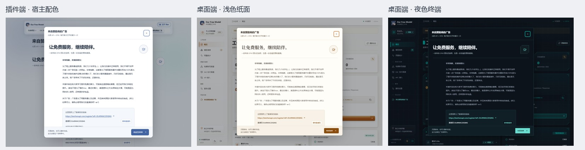

# 赞助广告入口与每日公告

本次增加赞助广告页面与每日一次的完整公告，不改变推理、账号、网关和登录业务。

## 界面预览



## 显示位置

- DSH 插件：顶部菜单增加“来自赞助商的广告”，可进入长文页面。
- 独立服务及桌面端：左侧“项目支持”下增加同名入口。窄窗口沿用现有横向菜单。
- 插件继承宿主配色；桌面端分别适配浅色纸面与深色终端主题。
- 完整公告的正文单独滚动，头部关闭按钮与底部“收起至菜单”始终可用。
- 收起时先让菜单进入可见区域，再把公告缩向该菜单并短暂强调入口。系统设置减少动效时立即收起。
- Esc 与点击遮罩也能立即收起，没有倒计时、阅读进度要求或自动外跳。

## 每天一次的边界

首次成功打开界面后，等待 700ms 尝试展示；登录界面、后台窗口和已有其他模态窗口时不会抢占。
插件所在的宿主设置弹窗不作为避让对象；同一设置页中另开的业务弹窗仍需关闭后才展示公告。
公告打开时 Esc 只收起公告并将焦点返回广告菜单，不触发宿主设置页的 Esc 关闭操作。
“今天”按设备本地年月日判断，不使用 UTC 日期。记录键为 `ofm.sponsor.last-shown.v1`，公告成功打开后才保留记录。
刷新、切页、组件重新挂载和同源多窗口都沿用记录；支持 Web Locks 的浏览器在并发窗口之间串行处理展示。
浏览器不允许访问或写入本地存储时跳过自动公告，仍保留广告菜单，避免每次刷新重复弹出。

记录属于当前浏览器/桌面应用的数据环境与站点地址。不同浏览器、不同端口、不同桌面配置以及清空站点数据后，各有自己的首次记录。
界面保持开启跨过午夜时不会在操作中突然弹出；下一次进入或回到该界面时按新日期判断。

## 内容与资源

- `src/sponsor.js`：原文、注册链接、邀请码、群号、日期规则和共用 React 组件。
- `src/sponsor.css`：共用排版及三种视觉适配。
- `docs/images/sponsor-beichen-examples.jpg`：用户提供的原始附图。
- `scripts/build-sponsor.mjs`：将共用组件、样式、附图内联进插件 `client.js`。附图不依赖外部图床。
- `packages/standalone/frontend/sponsor.tsx`：独立端使用同一套组件与图片。

注册链接实际使用标准半角问号，邀请码为 `DL49WAC2DQNG`；外链只在用户主动点击后打开。
图片作为提供的生成示例展示，不增加独立验证的承诺。

修改内容后运行：

```powershell
node scripts/build-sponsor.mjs
node scripts/build-standalone-ui.mjs
node scripts/sponsor-test.mjs
npm run typecheck:standalone
```

独立端构建会同步更新插件内联组件；`--check` 只检查一致性，不写文件。
自动离线测试包含每日规则测试。真实浏览器测试为 `node scripts/sponsor-ui-test.mjs`，可通过 `OFM_PLAYWRIGHT_MODULE` 指向已有 Playwright 模块、`OFM_BROWSER_PATH` 指向浏览器，以及 `OFM_SPONSOR_OUTPUT` 指定截图目录。

本次只更新源码和网页构建文件，未重新生成 Windows EXE 或安装包，也未生成新的发布签名。
