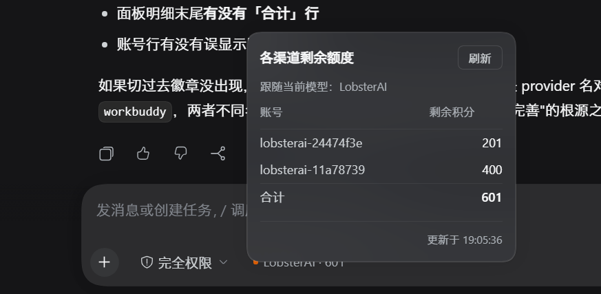
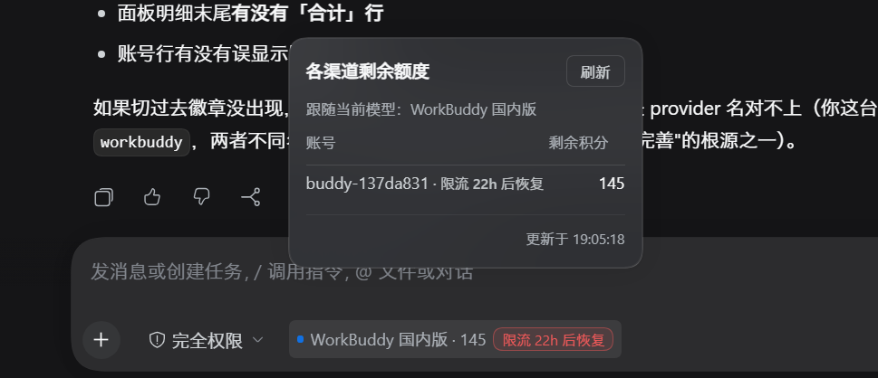

# composer 额度徽章：多账号合计与限流判定验收

日期：2026-10-18。范围：`client.js` 的 composer 额度徽章（`QuotaChip`）、渠道余额面板、限流状态读取。

## 问题定位

本 PR 最初版本在真实安装上暴露两个缺陷，均由用户实测报告：

**一、多账号渠道只显示单账号额度。**

初版 `readingOfChannel` 取余额最大的那个账号作为渠道读数。但插件本身支持自动切号，账号池就是**可累加使用的容量**：取最大值会少报，用户会以为额度只剩一份。真实例子是 LobsterAI 的两个账号 201 + 400，界面却只报 400。

现改为：数值类渠道（剩余积分、Token、余额）对**所有可用账号求和**；百分比类渠道（Gemini 的 `capability.quota`）百分比不可相加，按账号并列展示；停用账号不参与服务，既不计入额度也不参与限流判定。面板明细末尾增加「合计」行，让明细与徽章数字能对上。

**二、限流判定从未排除停用账号。**

`credits.balances` 返回的行不带 `enabled` 与 `modelRateLimits`，这两项来自 `account.list`。初版合并时只搬运了 `modelRateLimits`，**丢掉了 `enabled`**，于是 `account?.enabled === false` 恒为假——停用账号也被算进「全部账号是否都限流」的判定，可能误报「限流」也可能漏报。

现改为合并时同时保留 `enabled` 与 `modelRateLimits`。判定口径与 host 的 `allAccountsRateLimitedForModel` 对齐：只看当前模型的 `modelRateLimits` 精确匹配，且**所有启用账号都受限**才提示；任一账号可用就不提示；已过期的标记不算。

## 数据边界

- 额度求和依赖 `credits.balances` 每个账号的 `balance.total`；读不到余额的账号跳过，不当作 0 计入。
- 限流的权威数据是 `account.list` 里每个账号的 `modelRateLimits[modelId]`，由 host 的 `updateModelRateLimit` 写入，不是客户端推测。
- 「全部限流」的判定输入只含**启用账号**，与 host 的 `throwIfAllAccountsRateLimited` 一致（该处同样是 `listAccountsByProvider(...).filter(a => a.enabled)`）。
- 徽章只对 `CHANNEL_CREDITS` 表内的渠道显示。若 DSH 里给同一渠道配了别的 provider 名（本机存在 `workbuddy-global` 与账号侧 `workbuddy` 不同名的情形），徽章不会出现——这是有意的静默，不是数据缺失。
- 永久锁（`permanent-locks.json` / `loomyPermanentLocked`）不参与本轮改动；host 的可用账号过滤同样只依据 `enabled` 与 `modelRateLimits`。

## 验收

真实账号、真实 DSH 桌面端（深色主题），两张截图覆盖两个修复点。

### 多账号求和与合计行

LobsterAI 的两个账号分别 201 与 400，徽章显示合计 **601**，面板明细两行之下有「合计 601」，与徽章一致。

### 限流标记沿真实数据正确显示

WorkBuddy 国内版（`buddy` 渠道）的账号 `buddy-137da831` 在 `modelRateLimits` 中带有一条 `deepseek-v4.1-flash` 的未到期标记，徽章旁因此出现红色「限流 22h 后恢复」，面板对应账号行也带同一提示。该账号是池中唯一账号，故符合「全部启用账号都受限」的提示条件。

### 逻辑单测

11 项断言全部通过，覆盖：两账号求和、单账号保持自身数值、停用账号不计入合计、缺余额的账号跳过、部分账号限流不提示、全部启用账号限流才提示、取最早解禁时刻、别的模型限流不影响当前模型、过期标记不算限流、停用账号的限流不参与判定、quota 类百分比并列不相加。

## 未验证的部分

- 只在 `buddy`（单账号 + 限流）与 `lobsterai`（双账号求和）两个渠道上看到了真实界面截图。其余渠道的求和与限流展示由逻辑单测覆盖，未逐一截图，也未逐一核对上游余额数字。
- 未验证停用账号在真实界面上的表现（当前账号池里所有账号都是启用状态，`enabled` 字段齐全）。停用路径由断言覆盖。
- 未验证 percent 类渠道（Gemini）的并列展示在真实账号上的效果。
- 限流检测只覆盖 host 确实写入了 `modelRateLimits` 的渠道；某些渠道的限流或风控冷却走别的机制，不在本 PR 声称范围内。
