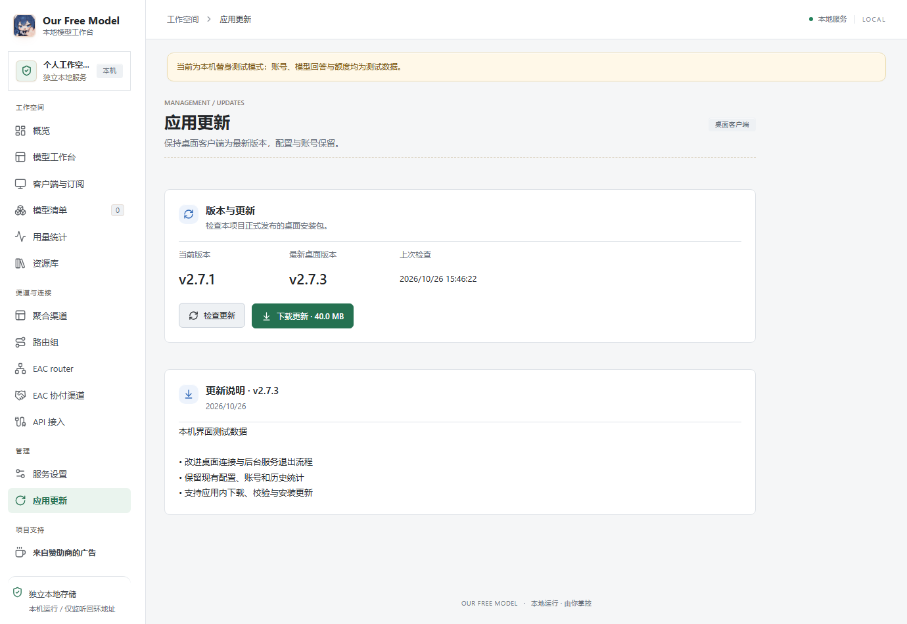
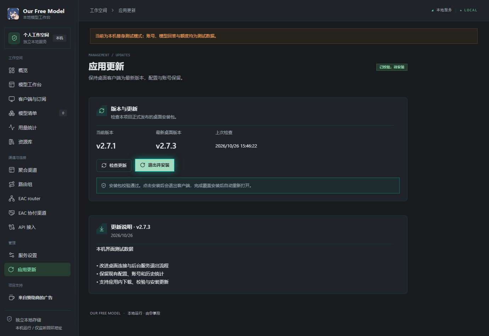

# 桌面内置更新验证

## 交付范围

左侧管理区新增「应用更新」，沿用现有侧栏、Card、Badge、Button、设置卡片与浅深色主题。展示原生桌面版本、最新桌面版本、检查时间、更新说明、下载进度、校验与安装状态。检查与下载在本机管理服务中执行，安装交接仅由绑定当前管理窗口的 Tauri IPC 执行。

本轮未提升产品版本、未公开发布桌面包、未替换用户现有安装。此前未内置更新栏目的桌面版需要先安装一次带此功能的新版，之后才能在应用内更新。

## 已执行验证

- `node scripts/test-all.mjs --mode contributor`：99/99 套件通过。
- `node scripts/desktop-update-test.mjs`：9/9 通过。覆盖版本选择、插件专用 Release 排除、架构匹配、固定来源、重定向限制、SHA256SUMS、损坏与超限下载、缓存重验、并发、恢复及真实管理接口权限。
- `cargo +1.96.1-x86_64-pc-windows-msvc test --manifest-path packages/desktop/src-tauri/Cargo.toml --release --lib`：6/6 原生测试通过。包括安装记录限制、固定路径、摘要复核、防降级、参数注入拒绝、交接等待顺序与 Windows 路径引用。
- Playwright Chromium 渲染当前真实构建资源：7/7 页面交互检查通过，未出现页面异常。覆盖新栏目、版本与说明、下载进度、校验失败、浅深主题、固定原生安装命令及浏览器禁用安装。
- `npm run typecheck`、`npm run typecheck:standalone`：通过。
- `node scripts/build-standalone-ui.mjs --check`、`node scripts/build-manifest.mjs --check`、`git diff --check`：通过。已发布插件的 79 项运行时内容和签名清单保持一致。
- 实际访问官方 GitHub Releases 的只读检查：运行桌面版本 2.7.1 时，最新桌面仍识别为 2.7.1，未把插件专用的 2.7.2 误认为桌面更新；未下载或执行安装器。

首次原生编译使用机器默认 GNU 工具链时，环境缺少 dlltool 的 PATH 配置。已改用机器上现有的 MSVC 1.96.1 工具链，编译与测试通过；不将首次失败算作通过。

## 视觉证据

以下使用真实前端与样式，版本 2.7.3 和更新说明为测试夹具，并在页面顶部明确标记测试模式；并非宣称已经发布该桌面版本。安装 IPC 使用替身，只记录固定命令，不退出真实应用。

## 安装与信任边界

下载仅限本仓库正式 GitHub Release 的匹配 Windows x64 安装包与同版本 SHA256SUMS，HTTPS 跳转只允许 GitHub 的资源域名。SHA 用于一致性校验，不声称它是独立数字签名。插件的 Ed25519 升级机制不受影响。

前端不能传递安装 URL、路径或参数。原生端验证私有缓存凭据、较新稳定版本、长度、目录和 SHA 后，停止自有后台，启动隐藏交接进程；交接确认就绪后才退出应用。交接进程等待旧 PID 退出，再次核对 SHA，并使用 Tauri NSIS 支持的 `/S /R /UPDATE` 参数安装和重启。启动交接失败会尝试恢复后台，安装失败会记录错误并尝试重新打开原程序。

未实际执行会覆盖用户安装的 NSIS 安装器，也未声称已经完成真实安装器端到端验收。此项需在后续桌面发布的隔离安装环境中执行。
