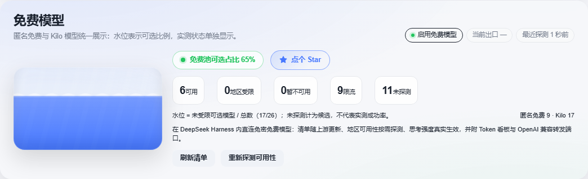

# Kilo 免费池与水位统计验证

免费页、标签数量、五格状态统计和水位统一使用匿名免费与 Kilo 模型，排除 EAC、聚合、订阅和组合路由。水位统计未受限且已公开的候选模型；仅列出的 Kilo 模型仍显示为未探测，不记为实测可用。限流、不可用、地区受限、隐藏及暂停状态不会抬高水位。

## 回归场景

26 个模型中，匿名免费 9 个全部限流，Kilo 17 个中 6 个实测可用、11 个未探测。水位为 17/26，四舍五入为 65%；五格状态为 6、0、0、9、11。

截图使用当前 `FreePage`、真实 React 服务端渲染和当前 CSS，经 Playwright Chromium 渲染截取。输入为上述离线夹具，浏览器网络请求全部拦截；该截图不代表真实上游可用性或用户桌面端验收。

## 验证命令

- `node --check client.js`：通过。
- `node scripts/free-pool-test.mjs`：12/12 通过，覆盖来源范围、状态计数、限流与恢复、隐藏、暂停、地区设置、空池和截图场景。
- `node scripts/stat-bucket-ui-test.mjs`：6 项通过。
- `npm run typecheck`：通过。
- `node scripts/build-standalone-ui.mjs`：生成当前独立端资源。
- `git diff --check`：通过。

完整贡献者测试及 CI 结果见 PR 验证记录。未调用真实 Kilo 或匿名模型上游；桌面端真实可用性由用户验收。
